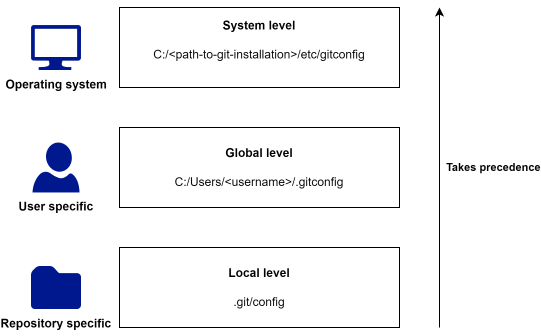

# Configuration of Git {#sec-configuration-of-git}

Section @sec-getting-started-basic-config briefly introduced how to configure Git using the `git config` command. This appendix explains how Git stores and organizes configuration settings in files. We also introduce several useful configuration variables and Git aliases.

Understanding Git configuration can help you troubleshoot unexpected settings and customize Git's behaviour. To keep the explanations accessible to beginners, this appendix focuses on common Git configuration scenarios and omits some advanced details and exceptions.


## Git configuration file structure

Git stores configuration settings in plain-text files, such as `~/.gitconfig`. A simple Git configuration file might look like this:

```{=html}
<div class="notepad-file">
<div class="notepad-header">.gitconfig</div>
<div class="notepad-body">
[user]<br>
&#160;&#160;&#160;&#160;name = Your Name<br>
&#160;&#160;&#160;&#160;email = your@email.com<br>
[core]<br>
&#160;&#160;&#160;&#160;editor = notepad<br>
</div>
</div>
```

The file contains *configuration settings* expressed as key-value pairs and grouped into sections identified by names in square brackets. A configuration setting is identified by its section name and key. For example, the `name` key in the `[user]` section is referenced as `user.name`. A configuration setting such as `user.name` is also called a *configuration variable*. The value assigned to this variable, such as `Your Name`, is called its *configuration value*.


## Git configuration scopes and precedence

Git uses three main configuration scopes: *system*, *global*, and *local*. These scopes determine which users and repositories the settings apply to. The same setting can be defined in multiple scopes. When this happens, settings from more specific scopes generally take precedence over settings from broader scopes. In other words, local settings take precedence over global settings, which in turn take precedence over system settings.

<div style="display:flex;justify-content:center;">
  <figure>
    
    <figcaption>Git configuration precedence</figcaption>
  </figure>
</div>

Suppose `core.editor` is set to `vim` in the system-level configuration file and to `notepad` in the global-level configuration file. Because global configuration takes precedence over system configuration, Git uses `notepad` as the effective value of `core.editor`. The system-level setting remains unchanged.


### System level

System-level configuration settings provide defaults for all users of the same Git installation. In a typical Git for Windows installation, the system-level configuration file is located at `C:/Program Files/Git/etc/gitconfig`. Editing this file typically requires administrator privileges on Windows.

System-level settings are useful when an administrator wants to establish defaults for all users of a computer, such as on a shared workstation or server. For example, an administrator could configure Notepad as the default Git editor for all users of a Windows server.


### Global level

Global configuration settings apply to Git commands run by a particular user. On Windows, the global configuration file is usually located in the user's home directory, for example, `C:/Users/<username>/.gitconfig`. 

The global scope is generally the appropriate place to configure your name, email address, aliases, and other personal settings. These settings apply to Git commands you run, unless overridden by settings with higher precedence.


### Local level

Local configuration settings apply to Git commands run in a particular Git repository. In a typical repository, the local configuration file is located at `.git/config` relative to the repository's root directory.

Local settings are useful when a repository needs different configuration settings than those defined globally. For example, if you are using Git on your work computer, you would probably set `user.email` to your work email in your global configuration file. If you also work on a personal Git project on the same computer, you could use the local configuration file to set `user.email` to your personal email in that specific repository.


## Working with configuration files

The `git config` command provides subcommands for inspecting and modifying Git configuration settings. You can use the `--system`, `--global`, and `--local` flags to work with settings from a particular configuration scope. Without these flags, Git generally reads settings from all applicable scopes and writes settings to the local scope.


### List configuration settings

To list the configuration settings Git reads in the current context, use `git config list`. To list only the settings from a specific scope, e.g. the global settings, use `git config list --global`. By default, `git config list` shows a list of settings with no additional information, and will include multiple instances of the same setting if it is defined in multiple configuration files that Git reads in the current context. For example, suppose `core.editor` is set to `vim` in the system configuration file and `notepad` in the global configuration file. The output of `git config list` might then look like this:

<pre class="terminal">
$ git config list
core.editor=vim
user.name=Your name
user.email=your@email.com
core.editor=notepad
</pre>

In Exercise 1, you will learn how to display the source and scope of each setting.


### Get the value of a configuration variable

Use `git config get [<scope>] <name>` to retrieve the value of a configuration variable, where `[<scope>]` is optional. If the target scope is not provided, the command returns the effective value according to configuration precedence. 

To retrieve the configuration value of `user.name` from the global configuration scope, you could run the following command:

<pre class="terminal">
$ git config get --global user.name
Your name
</pre>

If the requested variable is not defined, the command produces no output and exits with a nonzero status.


### Set the value of a configuration variable

Use `git config set [<scope>] <name> <value>` to set a configuration variable to a specified value. If no scope is specified, Git attempts to write the setting to the local repository configuration file. If the current working directory is not inside a Git repository, the command fails unless another target configuration file or scope is specified.

For example, to set `user.email` to `some@email.com` in the global configuration file, run:

<pre class="terminal">
$ git config set --global user.email some@email.com
</pre>


### Unset the value of a configuration variable

Use `git config unset [<scope>] <name>` to remove a configuration setting. For example, to remove the value of `core.editor` in the global configuration file, run:

<pre class="terminal">
$ git config unset --global core.editor
</pre>

Removing a setting does not necessarily remove its effective value if it is also defined in another scope.


### Edit a configuration file

Finally, you can make manual changes to a configuration file with `git config edit [<scope>]`. This opens the configuration file for the specified scope in Git's configured text editor. Without an explicit scope, this command opens the local configuration file and therefore requires a repository.


## Useful configuration settings

Git provides many configuration settings that control its behaviour. This section introduces a few particularly useful ones.


### `core.editor`

The `core.editor` setting specifies what text editor Git uses for operations that require editing text, such as writing commit messages. Git for Windows includes Vim, which is commonly used as the default text editor.

If you are not familiar with Vim, you can configure Git to use Windows Notepad with the following command:

<pre class="terminal">
$ git config set --global core.editor notepad
</pre>

Git can normally locate the Notepad executable by its command name. Alternatively, you can specify the full path to the Notepad executable explicitly. For example:

<pre class="terminal">
$ git config set --global core.editor "C:/Windows/System32/notepad.exe"
</pre>

### `commit.template`

The `commit.template` setting specifies a file whose contents Git uses as the initial text when Git opens a text editor for composing a commit message. For example, the following text could be used as a template containing reminders for writing a useful commit message. 

```{=html}
<div class="notepad-file">
<div class="notepad-header">.git-commit-template</div>
<div class="notepad-body">
<pre>
# Subject: Brief summary in imperative mood (max. 50 characters)
# Capitalize the first word; do not end with a period
# This line is 50 characters######################
# Body: Explain what changed and why, not how
# Separate from subject with a blank line; wrap at 72 characters
# This line is 72 characters############################################
</pre>
</div>
</div>
```

By default, Git removes lines starting with `#` before saving the commit message. The template provides guidance, but you must write the commit message yourself.

To use this file as a template for commit messages, save it as `~/.git-commit-template` and configure Git using the following command:

<pre class="terminal">
$ git config set --global commit.template ~/.git-commit-template
</pre>


### `user.name` and `user.email`

The `user.name` and `user.email` settings provide the default name and email address recorded in the author and committer information of new commits. Configure these settings to ensure that new commits are attributed to your intended name and email address.


## Aliases

Git aliases let you define shortcuts for Git commands. Aliases are particularly useful for commands that are frequently used but difficult to remember or tedious to type. As a contrived example, consider the `git status` command. You will probably use this command frequently. Git does not automatically recognize abbreviated subcommand names, but you could set up an alias allowing you to type `git st` instead of `git status`.

<pre class="terminal">
$ git config set --global alias.st status
</pre>

As seen above, aliases are settings in configuration files in the `alias` section. The value specifies the Git command and any additional arguments to use. If the alias value contains spaces, enclose the value in quotes. Choose a descriptive alias name that does not conflict with an existing Git subcommand.

A more practical example is the `git log` command. Unlike graphical Git clients, Git's command-line interface does not display the commit history as a graph by default. However, `git log --graph` can display a text-based representation of the history. For example, the following command displays a compact, text-based graph of the commit history:

<pre class="terminal">
$ git log --graph --oneline --all
</pre>

As mentioned above, `--graph` displays a text-based representation of the history, `--oneline` condenses information about each commit to one line, and `--all` tells Git to consider all references, including branches, when displaying the history. Because the command combines several flags, it is a useful candidate for an alias:

<pre class= "terminal">
$ git config set --global alias.graph "log --graph --oneline --all"
</pre>

You can now run `git graph` to execute `git log --graph --oneline --all`.


## Exercises

### Exercise 1

Your task in this exercise is to configure global settings, create a repository with local settings, and define an alias for a useful command.

<b>1. Configure global settings.</b>

Configure Git to use a text editor of your choice globally. If you are using Windows, Notepad is a sensible option. Also configure your name and email address in the global scope.

::: {.callout-tip title="Hint" collapse="true" icon="false"}

You can use `git config set` to set values of configuration variables. You need to consider what scope you should specify with the command.

:::

::: {.callout-note title="Solution" collapse="true" icon="false"}

<pre class="terminal">
$ git config set --global core.editor notepad
$ git config set --global user.email your@email.com
$ git config set --global user.name "Your Name"
</pre>

:::

<b>2. Create a repository and configure local settings.</b>

Create a directory named `ex01-git-config` in your home directory, navigate into it, and initialize a Git repository. In the repository's local configuration file, set `user.email` to a different value.

::: {.callout-note title="Solution" collapse="true" icon="false"}

<pre class="terminal">
$ mkdir ~/ex01-git-config
$ cd ~/ex01-git-config
$ git init
$ git config set --local user.email another@email.com
</pre>

:::

<b>3. Get the values of `core.editor` and `user.email`.</b>

While your current working directory is still `~/ex01-git-config`, retrieve the effective values of the `core.editor` and `user.email` configuration variables. Before running the commands, predict which values Git will return based on the configuration scopes and their precedence. Then run the commands to verify your predictions.

::: {.callout-note title="Solution" collapse="true" icon="false"}

<pre class="terminal">
$ git config get core.editor
notepad
$ git config get user.email
another@email.com
</pre>

The effective value of `core.editor` is `notepad` because it is defined globally and is not overridden by a local setting. The `user.email` setting is defined in both the global and local configuration files. The local value, `another@email.com`, takes precedence and is therefore returned.

:::

<b>4. List all configuration settings.</b>

List all configuration settings, including the scope and source file of each setting.

::: {.callout-tip title="Hint" collapse="true" icon="false"}

Consult the documentation for `git config list` to identify flags that display each setting's scope and source file.

:::

::: {.callout-note title="Solution" collapse="true" icon="false"}

Your output may differ from the example below, which shows only settings relevant to this exercise.

<pre class="terminal">
$ git config list --show-scope --show-origin
global  file:C:/Users/<username>/.gitconfig       user.name=Your Name
global  file:C:/Users/<username>/.gitconfig       user.email=your@email.com
global  file:C:/Users/<username>/.gitconfig       core.editor=notepad
local   file:.git/config        user.email=another@email.com
</pre>
:::

<b>5. Make an alias.</b>

Suppose you frequently use the command from the previous step but find its flags difficult to remember or tedious to type. Make an alias for the command in your global configuration file. Choose an alias name that does not conflict with an existing Git subcommand. For example, you could name the alias `config-show`.

::: {.callout-note title="Solution" collapse="true" icon="false"}

<pre class="terminal">
$ git config set --global alias.config-show "config list --show-scope --show-origin"
</pre>

:::

<b>6. Test the alias.</b>

Test the alias by running it and verifying that it displays the configuration settings with their scopes and source files.

::: {.callout-note title="Solution" collapse="true" icon="false"}

<pre class="terminal">
$ git config-show
</pre>

:::