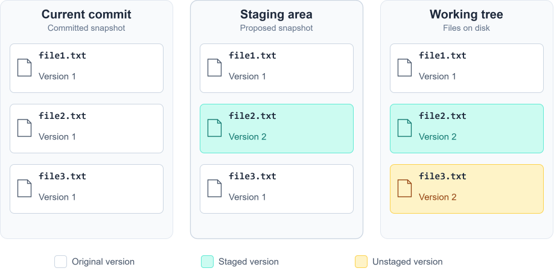
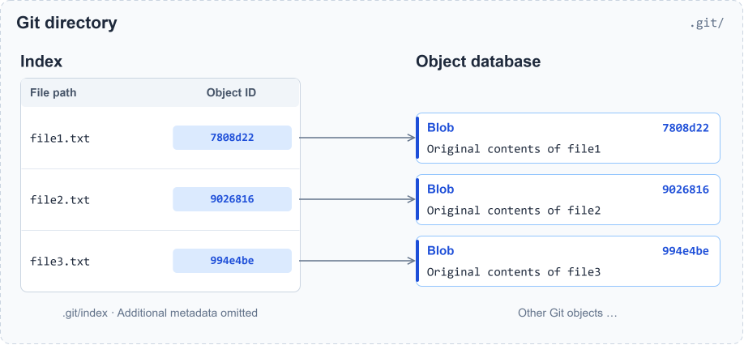
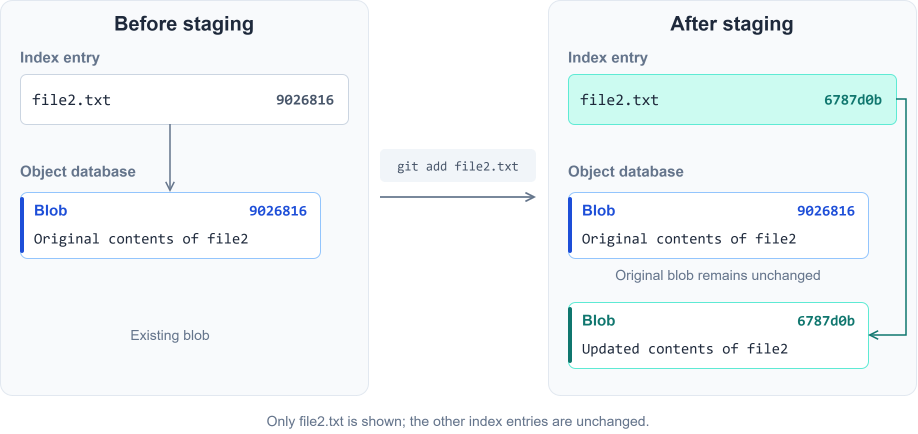
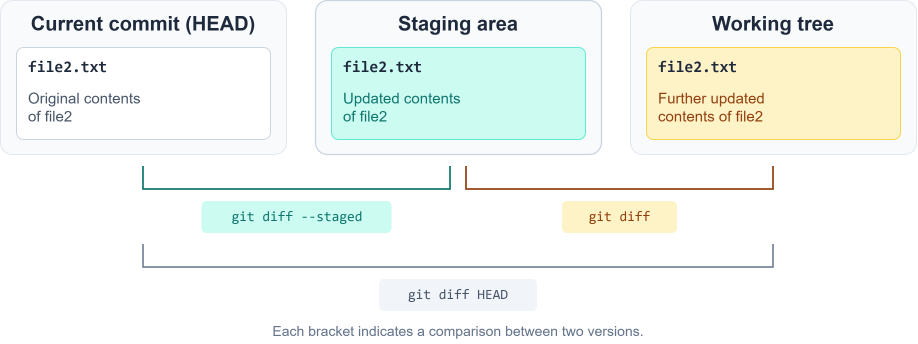
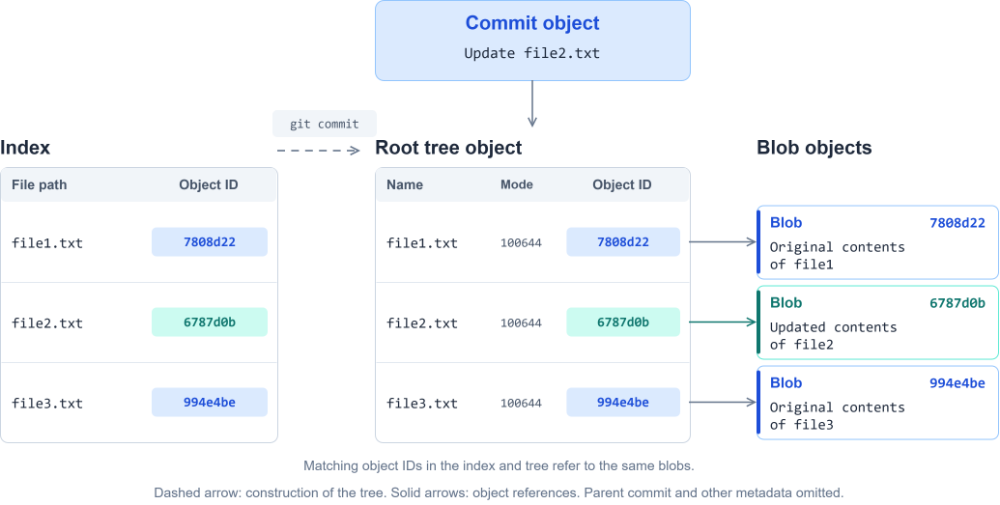
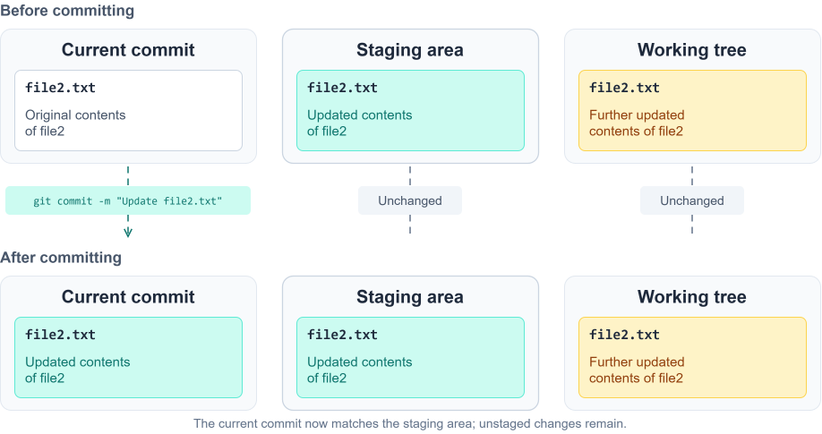
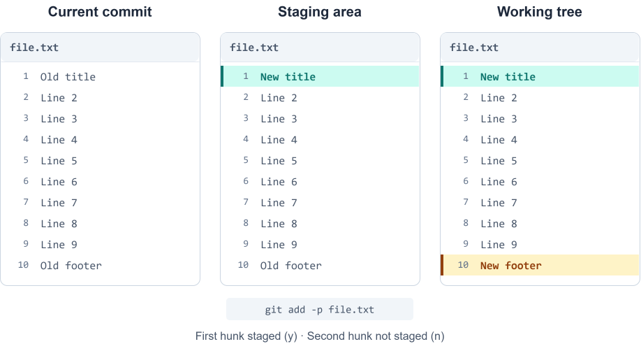

# The staging area {#sec-git-index}

Throughout this tutorial, we have used the staging area to prepare changes to be included in commits. We have also compared the contents of the staging area with those of the working tree and the current commit and used several commands to modify the contents of the staging area. In this appendix, we will examine the staging area in more detail to gain a better understanding of how these operations work. We will also learn how to stage individual changes to a file rather than all changes to the file.


## What is the staging area?

As explained in @sec-getting-started, the staging area represents the snapshot of the files that will be recorded in the next commit. It is also commonly referred to as the *index* in Git's documentation.

When we create a commit, we are not simply recording the changes that we have added to the staging area since the previous commit. We are recording a snapshot of the files in the repository. The staging area represents this entire snapshot, including the files that have not changed since the current commit. When we stage changes, we modify this proposed snapshot.

To illustrate this, consider a repository containing three tracked files, `file1.txt`, `file2.txt`, and `file3.txt`. Suppose that we have modified both `file2.txt` and `file3.txt` in the working tree but have only staged the changes to `file2.txt`. The following figure illustrates the versions of the files represented in the current commit, the staging area, and the working tree. TODO: could be made explicit that there is already at least one commit in the repository, so that a current commit exists.

<div style="display:flex;justify-content:center;">
  <figure>
    
    <figcaption>The staging area represents all three files, even though only the changes to <code>file2.txt</code> have been staged.</figcaption>
  </figure>
</div>

Although we have only staged changes to `file2.txt`, the staging area represents versions of all three files. If we were to create a commit at this point, it would record the updated version of `file2.txt` along with the original versions of `file1.txt` and `file3.txt`.

When we use `git status`, Git does not display all the files represented in the staging area. Instead, it compares the staging area with the current commit to determine which changes have been staged. It also compares the working tree with the staging area to determine which changes to tracked files have not been staged and reports any untracked files that are not ignored.

Thus, we should distinguish between the files represented in the staging area and the changes that have been staged. The former constitute the proposed snapshot, while the latter are the differences between this snapshot and the current commit.

When we use `git add` to stage a new file, Git adds an entry for the file to the staging area. When we stage changes to an existing file, Git updates its entry. When we stage the deletion of a file, for example using `git rm`, Git removes its entry from the staging area. In each case, we modify the snapshot that will be recorded in the next commit.


## Why do we have a staging area?

Throughout much of this tutorial, we have used `git add` followed immediately by git commit to record changes in the repository. You may therefore wonder why Git has a staging area at all rather than simply allowing us to commit changes directly from the working tree.

When working on a project, we often make several changes before creating a commit, and these changes may serve different purposes. For example, while implementing a new feature, we may discover and fix an unrelated bug. Rather than recording all the changes in a single commit, we may want to create one commit for the bug fix and another for the new feature. Using the staging area, we can stage and commit the changes related to the bug fix while leaving the changes related to the new feature in the working tree to be committed later.

The staging area also allows us to prepare a commit gradually by staging changes as we decide that they should be included in the next commit. Before creating the commit, we can review the changes we have staged using git diff --staged and, if necessary, stage additional changes or unstage changes that should not be included.

As we will see later in this appendix, we can even stage individual changes to a file rather than all changes to that file.

The staging area thus allows us to separate the process of making changes to a project from the process of deciding which changes to record together in a commit. This helps us create commits that each serve a well-defined purpose and thereby maintain a more meaningful commit history.


## How the staging area works

So far, we have described the staging area as representing a snapshot of the files in the repository. However, the staging area does not actually contain copies of the files themselves.

In a typical Git repository, the staging area is stored in a binary file named `index` in the Git directory (`.git/index`). The contents of the files represented in the staging area are stored separately as objects in the Git directory. A Git object containing the contents of a file is called a *blob* (short for *binary large object*). Each blob has an object ID that is computed from its contents together with a small header, much like the IDs used to identify commits.

When we stage an ordinary file using `git add`, Git stores its contents as a blob if the corresponding blob does not already exist. Git then records the path of the file relative to the root of the repository, the object ID of the blob, and some additional information in the index. If the file already has an entry in the index, Git updates that entry to represent the version we have just staged. The blob itself does not contain the name of the file.

<div style="display:flex;justify-content:center;">
  <figure>
    
    <figcaption>The index records file paths and object IDs, while the contents of the files are stored as blob objects in the Git directory.</figcaption>
  </figure>
</div>

We can use `git ls-files --stage` to examine the entries in the index. Let's create a new repository and create three files in the working tree. In the following examples, some output from setup and commit commands has been omitted. The object IDs shown are from a repository using SHA-1 and the file contents shown in the examples; the IDs or their abbreviated lengths may differ in your repository: (TODO: SHA-1 have been introduced in the main chapters, but for a beginner maybe it would be helpful to add a little more detail to the sentence of how SHA-1 is used to compute a checksum used as the object ID)

<pre class="terminal">
$ mkdir ~/example-staging-area
$ cd ~/example-staging-area
$ git init
$ echo "Original contents of file1" > file1.txt
$ echo "Original contents of file2" > file2.txt
$ echo "Original contents of file3" > file3.txt
$ git add .
$ git ls-files --stage
100644 7808d22282b7b0b618b4bbb5ca085d669cd5c84e 0       file1.txt
100644 90268164ca5861890a917879c7b09a0f7c93f514 0       file2.txt
100644 994e4be8b752fa9ea15655efa78d815eb9c2250d 0       file3.txt
</pre>

The output contains one line for each of the three files that we have added to the staging area. The following table describes the four columns of the output.

```{=html}
<table>
  <thead>
    <tr>
      <th>Column</th>
      <th>Description</th>
    </tr>
  </thead>
  <tbody>
    <tr>
      <td>File mode</td>
      <td>Indicates the type of file and, for ordinary files, whether the file is executable. The value <code>100644</code> represents an ordinary non-executable file.</td>
    </tr>
    <tr>
      <td>Object ID</td>
      <td>The ID of the object containing the staged file contents (a blob for an ordinary file).</td>
    </tr>
    <tr>
      <td>Stage number</td>
      <td>Normally <code>0</code>. Other values are used to represent different versions of a file during the resolution of merge conflicts.</td>
    </tr>
    <tr>
      <td>File path</td>
      <td>The path of the file, relative to the root of the repository when the command is run from that directory.</td>
    </tr>
  </tbody>
</table>
```
TODO: Add column number to table?

Notice that Git has already stored the contents of the three files as objects and recorded their object IDs in the index, even though we have not yet created a commit in the repository. Staging a file does not create a commit.

Now let's create the first commit in the repository:

<pre class="terminal">
$ git commit -m "Add three files"
$ git ls-files --stage
100644 7808d22282b7b0b618b4bbb5ca085d669cd5c84e 0       file1.txt
100644 90268164ca5861890a917879c7b09a0f7c93f514 0       file2.txt
100644 994e4be8b752fa9ea15655efa78d815eb9c2250d 0       file3.txt
</pre>

The output is identical to that before we created the commit. The entries for the three files remain in the index, even though there are no longer any staged changes in the repository.

Next, we modify `file2.txt` and `file3.txt` in the working tree and stage only the changes to `file2.txt`, as in the first figure of this appendix:

<pre class="terminal">
$ echo "Updated contents of file2" > file2.txt
$ echo "Updated contents of file3" > file3.txt
$ git add file2.txt
$ git ls-files --stage
100644 7808d22282b7b0b618b4bbb5ca085d669cd5c84e 0       file1.txt
100644 6787d0b110dfd75261b53b1f5a0a58759a32c854 0       file2.txt
100644 994e4be8b752fa9ea15655efa78d815eb9c2250d 0       file3.txt
</pre>

Notice that the output still contains entries for all three files. However, the object ID associated with `file2.txt` has changed, as the index now points to a blob containing the updated contents of the file. The object IDs associated with `file1.txt` and `file3.txt` have not changed.

<div style="display:flex;justify-content:center;">
  <figure>
    
    <figcaption>Staging a modified file updates its index entry to point to a blob containing the staged version of the file.</figcaption>
  </figure>
</div>

If we use `git status -s`, we see the following:

<pre class="terminal">
$ git status -s
<span class="col-green">M</span>  file2.txt
 <span class="col-red">M</span> file3.txt
</pre>

The output shows that the changes to `file2.txt` have been staged, while the changes to `file3.txt` have not. In contrast to `git ls-files --stage`, the output does not contain an entry for `file1.txt`, as the version of this file is the same in the current commit, the staging area, and the working tree.

We can use `git ls-files --stage` whenever we want to examine the entries in the index. In practice, however, we will generally be more interested in the differences between the staging area and the current commit or the working tree than in the entries themselves.


## Different versions of a file

In the previous example, the versions of `file2.txt` in the staging area and the working tree are identical but differ from the version in the current commit. Conversely, the versions of `file3.txt` in the staging area and the current commit are identical but differ from the version in the working tree.

However, the three versions of a file can also differ from one another. To illustrate this, let's modify `file2.txt` again without staging the new changes:

<pre class="terminal">
$ echo "Further updated contents of file2" > file2.txt
$ git status -s
<span class="col-green">M</span><span class="col-red">M</span> file2.txt
 <span class="col-red">M</span> file3.txt
</pre>

Notice that `git status -s` now displays two `M`s for `file2.txt`. This indicates that the file contains both staged and unstaged changes. The first `M` indicates that the version in the staging area differs from the version in the current commit. The second `M` indicates that the version in the working tree differs from the version in the staging area.

<div style="display:flex;justify-content:center;">
  <figure>
    
    <figcaption>The current commit, staging area, and working tree can contain three different versions of the same file.</figcaption>
  </figure>
</div>

We can use `git diff --staged` to examine the staged changes to `file2.txt`:

<pre class="terminal">
$ git diff --staged -- file2.txt
<span class="col-diff-file-header">diff --git a/file2.txt b/file2.txt</span>
<span class="col-diff-metadata">index 9026816..6787d0b 100644</span>
<span class="col-diff-markers">--- a/file2.txt</span>
<span class="col-diff-markers">+++ b/file2.txt</span>
<span class="col-diff-hunk-header">@@ -1 +1 @@</span>
<span class="col-diff-deletion">-Original contents of file2</span>
<span class="col-diff-addition">+Updated contents of file2</span>
</pre>

The output shows the changes between the version of `file2.txt` in the current commit and the version that we previously staged.

We can use `git diff` to examine the unstaged changes to the same file:

<pre class="terminal">
$ git diff -- file2.txt
<span class="col-diff-file-header">diff --git a/file2.txt b/file2.txt</span>
<span class="col-diff-metadata">index 6787d0b..514ba2d 100644</span>
<span class="col-diff-markers">--- a/file2.txt</span>
<span class="col-diff-markers">+++ b/file2.txt</span>
<span class="col-diff-hunk-header">@@ -1 +1 @@</span>
<span class="col-diff-deletion">-Updated contents of file2</span>
<span class="col-diff-addition">+Further updated contents of file2</span>
</pre>

Notice that the line removed in this output corresponds to the line added in the output of `git diff --staged`. This is because the version of the file represented in the staging area is used in both comparisons.

The example illustrates an important property of the staging area: when we stage a file, we stage its contents at that particular point in time. Subsequent modifications to the file in the working tree do not affect the version represented in the staging area.

In our example, if we were to use `git add file2.txt` again, Git would update the staging area to represent the version of the file in the working tree, and there would no longer be unstaged changes to the file. If we instead used `git restore file2.txt`, Git would restore the version of the file in the working tree using the version in the staging area, thereby discarding the unstaged changes. Finally, if we used `git restore --staged file2.txt`, Git would restore the staging area using the version of the file in the current commit without modifying the working tree. In the latter case, all changes to the file would be unstaged.

For now, we will leave the versions of the files in the example unchanged.


## From the staging area to a commit

When we use `git commit` without specifying any files or options that modify what is committed, Git creates a commit based on the snapshot represented in the staging area. As explained in @sec-inspecting-the-commit-history, the commit also contains information such as the author, the commit message, and references to its parent commits.

More specifically, Git uses the entries in the index to construct the snapshot as one or more objects called *tree objects*. Tree objects represent the structure of the files and directories in the snapshot and point to the objects containing their contents. The commit object points to the tree object representing the root of the snapshot. Git can reuse objects that already exist in the object database. In particular, the blobs containing the staged file contents have already been stored when the files were staged.

<div style="display:flex;justify-content:center;">
  <figure>
    
    <figcaption>Git creates a commit pointing to a tree object that represents the snapshot in the staging area. The tree and the index refer to the same file contents.</figcaption>
  </figure>
</div>

Let's commit the staged changes in our example without staging any further changes:

<pre class="terminal">
$ git commit -m "Update file2.txt"
$ git status -s
 <span class="col-red">M</span> file2.txt
 <span class="col-red">M</span> file3.txt
</pre>

Notice that there are still unstaged changes to both `file2.txt` and `file3.txt`, but there are no staged changes. The new commit records the version of `file2.txt` that we previously staged and the original versions of the other two files. The contents of the files in the working tree have not changed.

Let's examine the entries in the index again:

<pre class="terminal">
$ git ls-files --stage
100644 7808d22282b7b0b618b4bbb5ca085d669cd5c84e 0       file1.txt
100644 6787d0b110dfd75261b53b1f5a0a58759a32c854 0       file2.txt
100644 994e4be8b752fa9ea15655efa78d815eb9c2250d 0       file3.txt
</pre>

The output is identical to that before we created the commit. Git does not empty the staging area when we create a commit. Rather, the snapshot in the new current commit now matches the snapshot represented in the staging area. This is why `git status` no longer reports any staged changes.

<div style="display:flex;justify-content:center;">
  <figure>
    
    <figcaption>After creating a commit, the current commit matches the staging area, while the working tree remains unchanged.</figcaption>
  </figure>
</div>


## Partial staging

So far, when we have staged changes to a file, we have staged all changes to that file. However, sometimes we may want to include only some of the changes to a file in a commit. For example, we may have corrected an error and added a new feature in the same file, and we may want to record these two changes in separate commits.

We can stage individual changes using `git add -p`, where `-p` is short for `--patch`. Git displays the differences between the staging area and the working tree one hunk at a time and prompts us to decide whether to stage each hunk. This is commonly referred to as *partial staging*.

Let's create a new repository to illustrate how this works. In this example, we use `echo` with a quoted string spanning several lines to create a text file. If we enter the command one line at a time, Git Bash displays a continuation prompt (`>`) until we enter the closing quotation mark. We do not type the continuation prompts ourselves.

<pre class="terminal">
$ mkdir ~/example-partial-staging
$ cd ~/example-partial-staging
$ git init
$ echo "Old title
> Line 2
> Line 3
> Line 4
> Line 5
> Line 6
> Line 7
> Line 8
> Line 9
> Old footer" > file.txt
$ git add file.txt
$ git commit -m "Add file.txt"
</pre>

Next, we modify the first and last lines of `file.txt` by replacing the contents of the file with the following:

<pre class="terminal">
$ echo "New title
> Line 2
> Line 3
> Line 4
> Line 5
> Line 6
> Line 7
> Line 8
> Line 9
> New footer" > file.txt
</pre>

We have now made two independent changes to the file. We have updated the title on the first line and the footer on the last line. As the two changes are separated by several unchanged lines, Git normally displays them in separate hunks when we examine the differences.

Suppose that we want to record the change to the title in one commit and the change to the footer in another commit. We can use `git add -p file.txt` to stage only the change to the title:

<pre class="terminal">
$ git add -p file.txt
<span class="col-diff-file-header">diff --git a/file.txt b/file.txt</span>
<span class="col-diff-metadata">index e1eb383..4f39a0a 100644</span>
<span class="col-diff-markers">--- a/file.txt</span>
<span class="col-diff-markers">+++ b/file.txt</span>
<span class="col-diff-hunk-header">@@ -1,4 +1,4 @@</span>
<span class="col-diff-deletion">-Old title</span>
<span class="col-diff-addition">+New title</span>
 Line 2
 Line 3
 Line 4
(1/2) Stage this hunk [y,n,q,a,d,j,J,g,/,e,p,?]? y
<span class="col-diff-hunk-header">@@ -7,4 +7,4 @@ Line 6</span>
 Line 7
 Line 8
 Line 9
<span class="col-diff-deletion">-Old footer</span>
<span class="col-diff-addition">+New footer</span>
(2/2) Stage this hunk [y,n,q,a,d,K,g,/,e,p,?]? n
</pre>

For each hunk, Git presents us with several options. The available options may differ depending on the hunk being displayed and the version of Git we are using. The following options are sufficient for our example:

```{=html}
<table>
  <thead>
    <tr>
      <th>Option</th>
      <th>Description</th>
    </tr>
  </thead>
  <tbody>
    <tr>
      <td><code>y</code></td>
      <td>Stage the current hunk.</td>
    </tr>
    <tr>
      <td><code>n</code></td>
      <td>Do not stage the current hunk.</td>
    </tr>
    <tr>
      <td><code>q</code></td>
      <td>Quit without staging the current hunk or any of the remaining hunks.</td>
    </tr>
    <tr>
      <td><code>?</code></td>
      <td>Display a description of the available options.</td>
    </tr>
  </tbody>
</table>
```

We answer `y` when Git prompts us to stage the first hunk and `n` when Git prompts us to stage the second hunk. Consequently, the change to the title has been staged, whereas the change to the footer has not been staged.

<div style="display:flex;justify-content:center;">
  <figure>
    
    <figcaption>By staging only the first hunk, we create a version of <code>file.txt</code> in the staging area that contains the new title and the original footer.</figcaption>
  </figure>
</div>

Notice that the version of `file.txt` represented in the staging area differs from both the version in the current commit and the version in the working tree. Unlike in our previous example, this version has never existed in the working tree. Git has combined the unchanged contents of the staged version with the changes that we chose to stage and stored the resulting file contents as a blob.

Let's examine the staged changes:

<pre class="terminal">
$ git diff --staged
<span class="col-diff-file-header">diff --git a/file.txt b/file.txt</span>
<span class="col-diff-metadata">index e1eb383..10192d3 100644</span>
<span class="col-diff-markers">--- a/file.txt</span>
<span class="col-diff-markers">+++ b/file.txt</span>
<span class="col-diff-hunk-header">@@ -1,4 +1,4 @@</span>
<span class="col-diff-deletion">-Old title</span>
<span class="col-diff-addition">+New title</span>
 Line 2
 Line 3
 Line 4
</pre>

As expected, the change to the title has been staged. We can also examine the unstaged changes:

<pre class="terminal">
$ git diff
<span class="col-diff-file-header">diff --git a/file.txt b/file.txt</span>
<span class="col-diff-metadata">index 10192d3..4f39a0a 100644</span>
<span class="col-diff-markers">--- a/file.txt</span>
<span class="col-diff-markers">+++ b/file.txt</span>
<span class="col-diff-hunk-header">@@ -7,4 +7,4 @@ Line 6</span>
 Line 7
 Line 8
 Line 9
<span class="col-diff-deletion">-Old footer</span>
<span class="col-diff-addition">+New footer</span>
</pre>

The change to the footer remains unstaged. We can therefore commit the change to the title and subsequently stage and commit the remaining change to the footer:

<pre class="terminal">
$ git commit -m "Update title"
$ git add file.txt
$ git commit -m "Update footer"
$ git log --oneline
</pre>

The commit log now shows three commits: the initial commit, a commit recording the change to the title, and a commit recording the change to the footer. The two modifications to the file have been recorded in separate commits, even though we made both modifications in the working tree before creating either commit.

When we make several unrelated changes to a file, partial staging allows us to organize these changes into separate commits. This can make the commit history easier to understand and is particularly useful when we want each commit to represent a single logical change, as discussed in @sec-inspecting-the-commit-history.


## Summary

The staging area, also referred to as the index, represents the proposed snapshot that will be recorded in the next commit. It represents the versions of all files to be included in the snapshot, not just the files that have been modified since the current commit.

The index contains information about the files represented in the staging area, including their paths and the object IDs of the objects containing their contents. For ordinary files, these objects are referred to as blobs. When we stage changes, Git updates the entries in the index to represent the new versions of the files. Creating a commit does not empty the staging area.

The current commit, the staging area, and the working tree can contain different versions of the same file. Staged an unstaged changes are determined by comparing these versions.

The staging area allows to separate the process of making changes to a project from the process of deciding which changes to record together in a commit. Using `git add -p`, we can even stage individual hunks of changes to a file rather than staging all changes to the file at once. This helps us create commits that each server a well-defined purpose.


## Exercises

### Exercise 1 - Investigating the staging area

The purpose of this exercise is to investigate how some of the Git operations introduced throughout this tutorial affect the staging area. Throughout the exercise, try to predict the versions of the files represented in the current commit, the staging area, and the working tree before examining them using Git commands.

<b>Step 1.</b>

Use the following commands to create a new Git repository, create two files in the working tree, and stage the files:

<pre class="terminal">
$ mkdir ~/ex01-staging-area
$ cd ~/ex01-staging-area
$ git init
$ echo "Line 1" > file1.txt
$ echo "Line 1" > file2.txt
$ git add .
</pre>

Use `git ls-files --stage` to examine the entries in the index.

- Which files are represented in the staging area?
- Are the object IDs associated with the two files identical? Why or why not?

::: {.callout-note title="Solution" collapse="true" icon="false"}

Both `file1.txt` and `file2.txt` are represented in the staging area. The output of `git ls-files --stage` contains two entries with different file paths but identical object IDs. This is because the contents of the two files are identical. Git can use the same blob object to represent the contents of both files. The names of the files are recorded in the index, not in the blob.

:::

<b>Step 2.</b>

Create a commit with the commit message "Add two files". Examine the index again using `git ls-files --stage` and check the state of the files using `git status`.

- Have any of the entries in the index changed?
- Why does `git status` no longer report staged changes?

::: {.callout-note title="Solution" collapse="true" icon="false"}

<pre class="terminal">
$ git commit -m "Add two files"
$ git ls-files --stage
$ git status
</pre>

The entries in the index are unchanged. Git has created a commit recording the snapshot represented in the staging area. The versions of both files in the current commit, the staging area, and the working tree are now identical, so there are no staged or unstaged changes.

:::

<b>Step 3.</b>

Append the line `Line 2` to `file1.txt` and stage the change. Then append the line `Line 3` to the same file without staging the new change.

Before using `git ls-files --stage`, `git status -s`, `git diff`, and `git diff --staged` to examine the repository, answer the following questions:

- Which files are represented in the staging area, and which versions of the files are represented there?
- Which object IDs in the index have changed since step 2?
- Which changes to `file1.txt` are staged, and which are unstaged?

::: {.callout-note title="Solution" collapse="true" icon="false"}

<pre class="terminal">
$ echo "Line 2" >> file1.txt
$ git add file1.txt
$ echo "Line 3" >> file1.txt
$ git ls-files --stage
$ git status -s
<span class="col-green">M</span><span class="col-red">M</span> file1.txt
$ git diff
$ git diff --staged
</pre>

Both files are still represented in the staging area. The version of `file1.txt` in the staging area contains two lines, whereas the version of `file2.txt` still contains one line. Only the object ID associated with `file1.txt` has changed. The subsequent addition of `Line 3` in the working tree does not update the index entry.

The output of `git status -s` indicates that `file1.txt` contains both staged and unstaged changes. The output of `git diff --staged` shows the addition of `Line 2`, while the output of `git diff` shows the addition of `Line 3`.

:::

<b>Step 4.</b>

Commit the staged changes with a descriptive commit message without staging the remaining changes. Examine the repository using the same four commands as in step 3.

- Which versions of `file1.txt` are now represented in the current commit, the staging area, and the working tree?
- Has the output of `git ls-files --stage` changed?
- Which changes does Git now report as staged and unstaged?

::: {.callout-note title="Solution" collapse="true" icon="false"}

<pre class="terminal">
$ git commit -m "Add second line to file1.txt"
$ git ls-files --stage
$ git status -s
 <span class="col-red">M</span> file1.txt
$ git diff
$ git diff --staged
</pre>

Both the current commit and the staging area now represent the version of `file1.txt` containing two lines. The version in the working tree still contains three lines. The output of `git ls-files --stage` has not changed because the index still represents the same file contents as before the commit.

The output of `git diff --staged` is empty because the staging area matches the current commit. The output of `git diff` still shows the addition of `Line 3`. The unstaged change was not included in the commit and has not been discarded.

:::

<b>Step 5.</b>

Remove `file2.txt` using `git rm`. Examine the index and the staged changes using `git ls-files --stage` and `git diff --staged`.

- Which files are now represented in the staging area?
- If we were to create another commit at this point, which files and which versions of their contents would be recorded in the commit?

::: {.callout-note title="Solution" collapse="true" icon="false"}

<pre class="terminal">
$ git rm file2.txt
$ git ls-files --stage
$ git diff --staged
</pre>

The index now contains only an entry for `file1.txt`. The entry for `file2.txt` has been removed. The output of `git diff --staged` shows the deletion of `file2.txt`, as this file is present in the current commit but is no longer represented in the staging area.

If we were to create a commit at this point, it would record a snapshot containing only the version of `file1.txt` with two lines. The unstaged addition of `Line 3` to `file1.txt` would not be included.

:::


### Exercise 2 - Practising partial staging

The purpose of this exercise is to practise staging individual changes to a file and recording them in separate commits.

<b>Step 1.</b>

Use the following commands to create a repository with a file containing ten lines of text and commit the file:

<pre class="terminal">
$ mkdir ~/ex02-staging-area
$ cd ~/ex02-staging-area
$ git init
$ echo "Project: Example
> Line 2
> Line 3
> Line 4
> Line 5
> Line 6
> Line 7
> Line 8
> Line 9
> Version: 1" > file.txt
$ git add file.txt
$ git commit -m "Add project information"
</pre>

<b>Step 2.</b>

Modify the contents of the file as follows:

<pre class="terminal">
$ echo "Project: Git tutorial
> Line 2
> Line 3
> Line 4
> Line 5
> Line 6
> Line 7
> Line 8
> Line 9
> Version: 2" > file.txt
</pre>

Use `git diff` to examine the changes to the file. How many hunks are displayed, and which changes are shown in each hunk?

::: {.callout-note title="Solution" collapse="true" icon="false"}

<pre class="terminal">
$ git diff
</pre>

With the default diff context, the output contains two hunks. The first hunk shows that `Project: Example` has been replaced with `Project: Git tutorial`. The second hunk shows that `Version: 1` has been replaced with `Version: 2`.

:::

<b>Step 3.</b>

Suppose that you want to commit the change to the version number first and the change to the project name afterwards. Use partial staging to stage only the change to the version number.

Before creating a commit, use `git diff`, `git diff --staged`, and `git status -s` to verify that the intended change has been staged and the other change remains unstaged.

::: {.callout-note title="Solution" collapse="true" icon="false"}

Use `git add -p file.txt` and answer `n` when prompted to stage the first hunk and `y` when prompted to stage the second hunk.

<pre class="terminal">
$ git add -p file.txt
</pre>

The output of `git diff --staged` now shows only the change from `Version: 1` to `Version: 2`, whereas the output of `git diff` shows only the change to the project name. The output of `git status -s` shows two `M`s for `file.txt`, indicating that there are both staged and unstaged changes to the file.

:::

<b>Step 4.</b>

Create a commit containing the staged change, then stage and commit the remaining change. Use descriptive commit messages for both commits.

Finally, use `git log --oneline` and `git show` to verify that the two changes have been recorded in separate commits in the intended order. Use `git status` to check that there are no remaining changes to the file.

::: {.callout-note title="Solution" collapse="true" icon="false"}

<pre class="terminal">
$ git commit -m "Update version number"
$ git add file.txt
$ git commit -m "Update project name"
$ git log --oneline
$ git show HEAD^
$ git show HEAD
$ git status
</pre>

The commit log shows three commits. The current commit records the change to the project name, while its parent commit records the change to the version number. This can be verified by examining the output of `git show HEAD` and `git show HEAD^`. The working tree and staging area now match the current commit, so there are no staged or unstaged changes.

:::

TODO: the running example can be hard to follow. would it be easier for the reader with more self-contained examples that are shorter?