# Git references {#sec-git-references}

Throughout this tutorial, we have used names such as `main`, `origin/main`, and `HEAD` to identify commits without having to specify their commit IDs. These names are examples of Git references. In this appendix, we will take a closer look at what Git references are and how they work. This will help us better understand what happens when we perform some of the Git operations introduced throughout the tutorial.

This appendix assumes that the reader is familiar with branches and remote repositories, which were introduced in @sec-branching-and-merging and @sec-remotes.


## What are Git references?

Git identifies the objects stored in a Git repository using object IDs. Throughout this tutorial, we have already encountered one type of object ID, namely the commit ID. However, remembering and specifying these IDs whenever we wish to identify particular objects would be inconvenient. Instead, Git allows us to assign meaningful names to objects using references.

A Git reference is a name that points to either a Git object or another reference. Git references allow us to identify objects without having to specify their object IDs. Most of the references that we have encountered throughout this tutorial are used to identify commits.

For example, the branch name `main` is a reference that points to the last commit on the `main` branch. When we use `main` instead of a commit ID in a Git command, Git determines which commit the reference points to.

<div style="display:flex;justify-content:center;">
  <figure>
    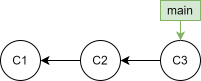
    <figcaption>The branch reference `main` points to commit C3</figcaption>
  </figure>
</div>

An important distinction between objects and references is that a reference can be changed to point to a different object without modifying either object. Furthermore, several references can point to the same object.

Git can store references as individual files in the `.git/refs/` directory. For example, the branch reference `main` may be stored in a file named `.git/refs/heads/main`. We can examine the contents of this file using `cat`:

<pre class="terminal">
$ cat .git/refs/heads/main
af340cf8c95f55df3ab4cce9c102e01393631634
</pre>

As we can see, the file simply contains the ID of the commit that the branch reference points to.

However, Git does not necessarily store references as individual files. We can instead use `git show-ref` to display references whose full names begin with `refs/`, along with their associated object IDs, regardless of how the references are stored. Note that the output of `git show-ref` does not include `HEAD` by default. We will examine the `HEAD` reference separately later in this appendix.

Consider the commit history shown below:

<div style="display:flex;justify-content:center;">
  <figure>
    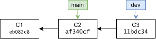
    <figcaption>Two branch references pointing to different commits</figcaption>
  </figure>
</div>

If we examined the references in this repository using `git show-ref`, we would get the following output:

<pre class="terminal">
$ git show-ref
11bdc34a7e8c4b3b3467f3d982607cf1f6420498 refs/heads/dev
af340cf8c95f55df3ab4cce9c102e01393631634 refs/heads/main
</pre>

Each line of the output contains an object ID followed by the full name of the corresponding reference. In this example, the branch references `dev` and `main` point to two different commits. Note that the output contains the full names of the references, `refs/heads/dev` and `refs/heads/main`, rather than the shorter names `dev` and `main` that we normally use when working with branches. The commit ID associated with `refs/heads/main` is the same as the one that we previously obtained by examining the contents of the `.git/refs/heads/main` file.

As we will see in the following sections, the prefixes in the full names of many references indicate the type of reference.


## Branch references

When we work with branches in Git, it may be tempting to think of each branch as a separate collection of commits. However, a branch is essentially a reference that points to the last commit on the branch. This commit is also referred to as the *tip* of the branch. Since a branch reference can be updated to point to another commit, branches in Git are often described as *movable pointers* to commits. Git can determine the history of the branch by following the parent relationships between commits, starting at the commit that the branch reference points to.

The full name of a branch reference consists of the prefix `refs/heads/` followed by the name of the branch. For example, the full name of the reference for the `main` branch is `refs/heads/main`.

When we create a new branch, Git creates a new branch reference that points to an existing commit. No commits are created or copied as a result of creating the branch. This is why creating a branch in Git is a very fast operation, even in repositories with an extensive commit history.

Suppose that we have a repository containing a branch named `main` whose history consists of three commits. If we create a new branch named `dev` at the last commit on the `main` branch, both branch references will initially point to the same commit.

<div style="display:flex;justify-content:center;">
  <figure>
    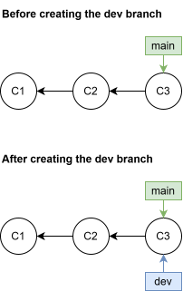
    <figcaption>Creating a branch</figcaption>
  </figure>
</div>

If we subsequently switch to the `dev` branch and create a new commit, Git updates the `dev` reference to point to the newly created commit. The `main` reference remains unchanged.

<div style="display:flex;justify-content:center;">
  <figure>
    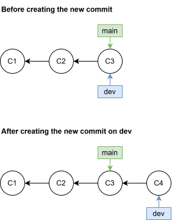
    <figcaption>Creating a commit on the `dev` branch</figcaption>
  </figure>
</div>

A branch reference can also be moved to an existing commit. For example, this happens when we perform a fast-forward merge or use `git reset` to change the current commit while on a branch.

The distinction between a branch reference and the commits that constitute the history of the branch is also important when deleting branches. When we delete a branch, Git removes the branch reference, but it does not immediately remove any of the commits that were part of the history of the branch.

Suppose that we switch back to the `main` branch and forcibly delete the `dev` branch in the example above.

<div style="display:flex;justify-content:center;">
  <figure>
    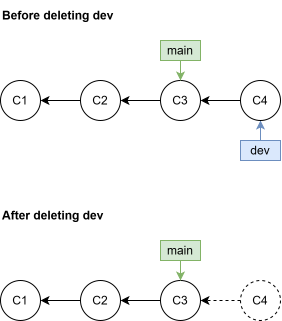
    <figcaption>Deleting the `dev` branch</figcaption>
  </figure>
</div>

Although commit C4 is no longer part of the history of any branch, the commit object still exists in the repository. This is why it is often possible to recover commits that we have seemingly lost, for example by using reflogs, as described in @sec-git-reflog.

Git may eventually remove commit objects that can no longer be reached through references or reflogs, but deleting a branch reference does not immediately remove these objects.


## The HEAD reference

Throughout this tutorial, we have used `HEAD` to identify the current commit. However, unlike a branch reference, `HEAD` does not normally point directly to a commit. Instead, it points to the reference for the current branch.

A reference that points to another reference rather than directly to a Git object is called a *symbolic reference*.

For example, if we are currently on the `main` branch, `HEAD` points to the branch reference `refs/heads/main`, which in turn points to a commit. Consequently, `HEAD` identifies the current commit indirectly through the branch reference.

<div style="display:flex;justify-content:center;">
  <figure>
    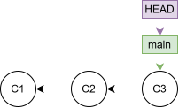
    <figcaption>`HEAD` as a symbolic reference</figcaption>
  </figure>
</div>

We can inspect the `HEAD` reference by displaying the contents of the `.git/HEAD` file. For example, if we are currently on the `main` branch, the contents of this file will typically be as follows:

<pre class="terminal">
$ cat .git/HEAD
ref: refs/heads/main
</pre>

The prefix `ref:` indicates that `HEAD` is a symbolic reference, and `refs/heads/main` is the full name of the reference that it points to.

We can also include `HEAD` in the output of `git show-ref` by using the `--head` option. However, unlike the contents of the `.git/HEAD` file, the output of `git show-ref --head` does not reveal whether `HEAD` identifies the current commit directly or indirectly. For `HEAD`, it only shows the ID of the current commit.

<pre class="terminal">
$ git show-ref --head
af340cf8c95f55df3ab4cce9c102e01393631634 HEAD
11bdc34a7e8c4b3b3467f3d982607cf1f6420498 refs/heads/dev
af340cf8c95f55df3ab4cce9c102e01393631634 refs/heads/main
</pre>

The output shows that `HEAD` and `refs/heads/main` identify the same commit, but it does not reveal the relationship between the two references.

Understanding this relationship between `HEAD` and branch references helps explain what happens when we switch branches and create commits.

When we switch to another branch, Git updates `HEAD` to point to the reference for that branch and updates the contents of the staging area and the working tree as needed. The branch references themselves remain unchanged.

<div style="display:flex;justify-content:center;">
  <figure>
    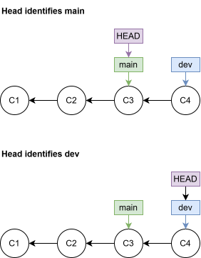
    <figcaption>Switching branches</figcaption>
  </figure>
</div>

When we create a new commit while on a branch, Git updates the reference for the current branch to point to the newly created commit. `HEAD` continues to point to the same branch reference and thereby identifies the newly created commit indirectly.

<div style="display:flex;justify-content:center;">
  <figure>
    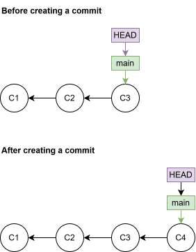
    <figcaption>Updating the current branch reference</figcaption>
  </figure>
</div>

Thus, although the current commit changes when we create a new commit while on a branch, `HEAD` itself remains unchanged.


### Detached HEAD

Although `HEAD` normally points to a branch reference, it can also point directly to a commit. When this is the case, we are said to be in a *detached HEAD* state.

We can enter a detached HEAD state by using `git switch --detach <commit>`, which allows us to switch to a particular commit rather than to a branch.

<div style="display:flex;justify-content:center;">
  <figure>
    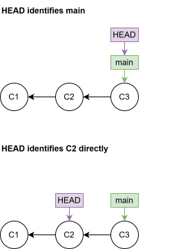
    <figcaption>Attached and detached `HEAD`</figcaption>
  </figure>
</div>

In a detached HEAD state, the `.git/HEAD` file contains a commit ID rather than the name of a branch reference, as shown below:

<pre class="terminal">
$ cat .git/HEAD
d8a31c27bf04e95a619d36c852fd0ab7e1439c65
</pre>

In a detached HEAD state, there is no current branch, but there is still a current commit. If we create a new commit, Git updates `HEAD` to point directly to the newly created commit rather than updating a branch reference.

<div style="display:flex;justify-content:center;">
  <figure>
    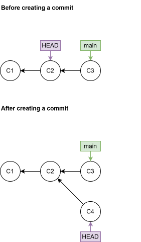
    <figcaption>Creating a commit in a detached HEAD state</figcaption>
  </figure>
</div>

If we subsequently switch to an existing branch, `HEAD` once again points to a branch reference. The commit that we created in the detached HEAD state may then be difficult to find, since it may not be part of the history of any branch.

If we wish to continue working from a commit created in a detached HEAD state, we can create a new branch at that commit and switch to it. `HEAD` will then point to the newly created branch reference rather than directly to the commit.


## Remote-tracking branches

Like local branch references, remote-tracking branch references point to commits. However, a remote-tracking branch records the last known state of a branch in a remote repository. For example, the remote-tracking branch `origin/main` records the last known state of the `main` branch in the remote repository associated with `origin`.

The full name of a remote-tracking branch reference consists of the prefix `refs/remotes/` followed by the name of the remote-tracking branch. For example, the full name of the reference for `origin/main` is `refs/remotes/origin/main`.

It is important to distinguish between the `main` branch in the remote repository and the remote-tracking branch `origin/main` in the local repository. Both the `origin/main` reference and the commit that it points to are stored in the local repository. Consequently, changes to the `main` branch in the remote repository are not necessarily reflected in `origin/main`.

Suppose that we have cloned a remote repository whose default branch is `main`. The history of the `main` branch consists of three commits. Immediately after cloning the repository, the `main` branch and the remote-tracking branch `origin/main` in the local repository point to the same commit. If a new commit is subsequently created on the `main` branch in the remote repository, neither of these references in the local repository will be automatically updated.

<div style="display:flex;justify-content:center;">
  <figure>
    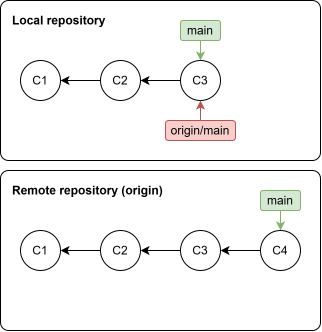
    <figcaption>Local and remote branch references</figcaption>
  </figure>
</div>

When we fetch changes from the remote repository using `git fetch`, Git retrieves the new commit and updates the remote-tracking branch reference `origin/main` to point to it. However, the `main` branch in the local repository remains unchanged.

<div style="display:flex;justify-content:center;">
  <figure>
    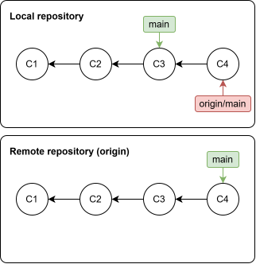
    <figcaption>Updating a remote-tracking branch</figcaption>
  </figure>
</div>

Thus, local branch references are updated when we, for example, create commits on the corresponding branches. Remote-tracking branch references are instead typically updated when we fetch changes from or successfully push changes to the corresponding branches in remote repositories.


## Tags

Another type of Git reference is a tag. Tags are typically used to assign meaningful names to particular commits in the history of a repository, for example to identify different versions of a project.

The full name of a tag reference consists of the prefix `refs/tags/` followed by the name of the tag. For example, the full name of the reference for a tag named `v1.0` is `refs/tags/v1.0`.

The main difference between branch references and tag references is that a branch reference is typically moved to point to different commits as we work on a branch, whereas a tag reference is intended to continue pointing to the same object.

For example, suppose that we create a tag named `v1.0` that identifies the last commit on the `main` branch. If we subsequently create a new commit on the `main` branch, Git updates the `main` reference to point to the newly created commit, but the tag continues to identify the same commit as before.

<div style="display:flex;justify-content:center;">
  <figure>
    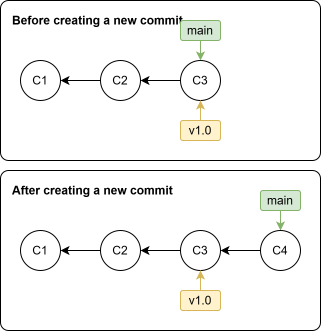
    <figcaption>The difference between branch and tag references</figcaption>
  </figure>
</div>

Although it is possible to change or delete tags, Git does not automatically update tags as we create new commits. Tags are therefore useful for identifying particular points in the history of a repository that we may wish to return to later.

There are two types of tags in Git: lightweight tags and annotated tags. A lightweight tag is a reference that points directly to the object with which the tag is associated, whereas an annotated tag is a reference that points to a separate Git object called a *tag object*. The tag object, in turn, points to another Git object and contains additional information, such as the name of the person who created the tag, the date of creation, and a message.

<div style="display:flex;justify-content:center;">
  <figure>
    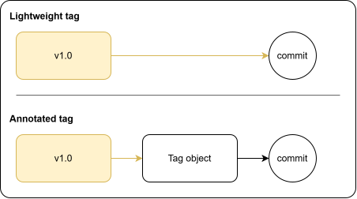
    <figcaption>Lightweight and annotated tags</figcaption>
  </figure>
</div>

Although lightweight and annotated tags differ in how they are associated with Git objects, both types of tags can be used to identify particular commits in the history of a repository.

We can create a lightweight tag named `v1.0` that points to the current commit using `git tag v1.0`. If we instead wish to create a lightweight tag that points to another commit, we can specify that commit using `git tag v1.0 <commit>`. We can use `git tag` without any arguments to list the tags in the repository.


## Identifying commits using references

Throughout this tutorial, we have used both commit IDs and Git references to identify particular commits. We can also identify commits relative to other commits using expressions such as `HEAD^` and `HEAD~2`.

Although we have primarily used these expressions in combination with `HEAD`, we can also use them in combination with other references, such as branch references and tags.

For example, the following table shows different ways of identifying commits using the `main` branch reference.

```{=html}
<table>
  <thead>
    <tr>
      <th>Expression</th>
      <th>Commit identified</th>
    </tr>
  </thead>
  <tbody>
    <tr>
      <td><code>main</code></td>
      <td>The last commit on the <code>main</code> branch.</td>
    </tr>
    <tr>
      <td><code>main^</code></td>
      <td>The first parent of the commit that <code>main</code> points to.</td>
    </tr>
    <tr>
      <td><code>main~1</code></td>
      <td>The first parent of the commit that <code>main</code> points to.</td>
    </tr>
    <tr>
      <td><code>main~2</code></td>
      <td>The commit reached by following the first parent twice from the commit that <code>main</code> points to.</td>
    </tr>
    <tr>
      <td><code>main~3</code></td>
      <td>The commit reached by following the first parent three times from the commit that <code>main</code> points to.</td>
    </tr>
  </tbody>
</table>
```

<div style="display:flex;justify-content:center;">
  <figure>
    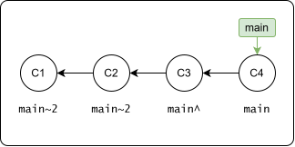
    <figcaption>Identifying commits using the `main` branch reference</figcaption>
  </figure>
</div>

It is useful to distinguish between references, such as `main` and `HEAD`, and expressions that use these references, such as `main^` and `HEAD~2`. These expressions are not themselves references but are evaluated by Git to identify particular commits.

For example, when we use `main~2` in a Git command, Git first determines which commit the `main` reference points to and then follows the first parent twice to identify the requested commit.

When a Git command accepts a commit ID as an argument, we can generally use one of these expressions instead. For example, we can use `git diff main~2 main` to compare the versions of files in the commits identified by `main~2` and `main`.

Git supports many other expressions for identifying commits. We can find a more comprehensive description of these expressions in the manual page accessed using `git help revisions`.


## Summary

Git references provide meaningful names that point to Git objects or other references. References can be changed to point to different objects without modifying the objects themselves.

In this appendix, we have examined the following types of Git references:

- Branch references point to the last commit on a branch. They are updated when new commits are created on the corresponding branches and can also be moved to existing commits.

- `HEAD` normally points to the reference for the current branch and thereby identifies the current commit indirectly. In a detached HEAD state, `HEAD` points directly to the current commit.

- Remote-tracking branch references record the last known state of branches in remote repositories.

- Tags are typically used to identify particular commits in the history of a repository and are not automatically updated when new commits are created.


The following table shows examples of the short and full names of the references that we have examined in this appendix and summarizes what the different types of references point to.

```{=html}
<table>
  <thead>
    <tr>
      <th>Type of reference</th>
      <th>Short name</th>
      <th>Full name</th>
      <th>Points to</th>
    </tr>
  </thead>
  <tbody>
    <tr>
      <td>Branch</td>
      <td><code>main</code></td>
      <td><code>refs/heads/main</code></td>
      <td>A commit</td>
    </tr>
    <tr>
      <td>HEAD</td>
      <td><code>HEAD</code></td>
      <td><code>HEAD</code></td>
      <td>A branch reference or a commit</td>
    </tr>
    <tr>
      <td>Remote-tracking branch</td>
      <td><code>origin/main</code></td>
      <td><code>refs/remotes/origin/main</code></td>
      <td>A commit</td>
    </tr>
    <tr>
      <td>Lightweight tag</td>
      <td><code>v1.0</code></td>
      <td><code>refs/tags/v1.0</code></td>
      <td>A Git object</td>
    </tr>
    <tr>
      <td>Annotated tag</td>
      <td><code>v2.0</code></td>
      <td><code>refs/tags/v2.0</code></td>
      <td>A tag object</td>
    </tr>
  </tbody>
</table>
```

We have also used `git show-ref` to display references and their associated object IDs and examined the contents of the `.git/HEAD` file to determine whether `HEAD` points to a branch reference or directly to the current commit.

Git references can also be used in expressions such as `HEAD^` and `main~2` to identify commits relative to those identified by the references.


## Exercises

### Exercise 1 - Investigating Git references

The purpose of this exercise is to investigate how some of the Git operations introduced throughout this tutorial affect the references in a Git repository.

Throughout the exercise, try to predict how the references in the repository will change before performing each Git operation. Compare your predictions with the output of the commands that you use to examine the references.

<b>Step 1.</b>

Use the following commands to create a new Git repository named `ex01-git-references`, create a file named `file1.txt` containing a single line of text, stage the file, and create a commit:

<pre class="terminal">
$ mkdir ~/ex01-git-references
$ cd ~/ex01-git-references
$ git init
$ echo "Line 1" > file1.txt
$ git add file1.txt
$ git commit -m "Add file1.txt"
</pre>

Use `git show-ref` and `cat .git/HEAD` to examine the references in the repository.

- Which references can we learn about from the output of the two commands?

- How does `HEAD` identify the current commit?

::: {.callout-note title="Solution" collapse="true" icon="false"}

<pre class="terminal">
$ git show-ref
00f39e85b413657f6f74c7b28461e29eea45a218 refs/heads/main
$ cat .git/HEAD
ref: refs/heads/main
</pre>

After we have created the first commit, the repository contains the branch reference `refs/heads/main`, which points to the newly created commit. Furthermore, `HEAD` is a symbolic reference that points to `refs/heads/main` and thereby identifies the current commit indirectly.

:::

<b>Step 2.</b>

Create a new branch named `dev` without switching to it. Use the same commands as in step 1 to examine the references in the repository.

- Which reference has been created?

- Which commit does the reference point to?

- Has `HEAD` changed?

::: {.callout-note title="Solution" collapse="true" icon="false"}

<pre class="terminal">
$ git branch dev
$ git show-ref
00f39e85b413657f6f74c7b28461e29eea45a218 refs/heads/dev
00f39e85b413657f6f74c7b28461e29eea45a218 refs/heads/main
$ cat .git/HEAD
ref: refs/heads/main
</pre>

Git has created a new branch reference named `refs/heads/dev`. Both `refs/heads/main` and `refs/heads/dev` point to the same commit. `HEAD` remains unchanged and continues to point to `refs/heads/main`.

:::

<b>Step 3.</b>

Switch to the `dev` branch and examine the references in the repository again.

- Which references have changed as a result of switching branches?

- Has the current commit changed?

::: {.callout-note title="Solution" collapse="true" icon="false"}

<pre class="terminal">
$ git switch dev
$ git show-ref
00f39e85b413657f6f74c7b28461e29eea45a218 refs/heads/dev
00f39e85b413657f6f74c7b28461e29eea45a218 refs/heads/main
$ cat .git/HEAD
ref: refs/heads/dev
</pre>

Neither of the branch references has changed, but `HEAD` now points to `refs/heads/dev` rather than `refs/heads/main`.

Although `HEAD` has changed, the current commit has not changed because both branch references point to the same commit.

:::

<b>Step 4.</b>

Add another line of text to `file1.txt`, stage the changes, and create a commit. Examine the references in the repository again.
   
- Which references have changed as a result of creating the commit?

- Has the current commit changed?

- Has `HEAD` itself changed?

::: {.callout-note title="Solution" collapse="true" icon="false"}

We can create another commit and examine the references again using the following commands:

<pre class="terminal">
$ echo "Line 2" >> file1.txt
$ git add file1.txt
$ git commit -m "Add second line to file1.txt"
$ git show-ref
39dba37a7107bae24cfe8fb0c301219f3e344697 refs/heads/dev
00f39e85b413657f6f74c7b28461e29eea45a218 refs/heads/main
$ cat .git/HEAD
ref: refs/heads/dev
</pre>

Git has updated the `refs/heads/dev` reference to point to the newly created commit. The `refs/heads/main` reference remains unchanged.

`HEAD` continues to point to `refs/heads/dev`. Consequently, although `HEAD` itself has not changed, the current commit has changed because `refs/heads/dev` now points to a different commit.

:::

<b>Step 5.</b>

Create a lightweight tag named `v1.0` that points to the current commit. Add another line of text to `file1.txt`, stage the changes, and create another commit. Show the commit history and examine the references in the repository again.

- Which commit does the `v1.0` tag point to?

- Which commit does the `dev` branch reference point to?

::: {.callout-note title="Solution" collapse="true" icon="false"}

We can create the tag and make another commit on the `dev` branch using the following commands:

<pre class="terminal">
$ git tag v1.0
$ echo "Line 3" >> file1.txt
$ git add file1.txt
$ git commit -m "Add third line to file1.txt"
</pre>

We can then show the commit history and examine the references:

<pre class="terminal">
$ git log --oneline
<span class="col-hash">9a47ffd</span> <span class="col-yellow">(</span><span class="col-head">HEAD</span> <span class="col-yellow">-></span> <span class="col-branch-local">dev</span><span class="col-yellow">)</span> Add third line to file1.txt
<span class="col-hash">39dba37</span> <span class="col-yellow">(</span><span class="col-tag">tag: v1.0</span><span class="col-yellow">)</span> Add second line to file1.txt
<span class="col-hash">00f39e8</span> <span class="col-yellow">(</span><span class="col-branch-local">main</span><span class="col-yellow">)</span> Add file1.txt
$ git show-ref
9a47ffdd6cfa4e668aeb67a01e5d8b321a250a0f refs/heads/dev
00f39e85b413657f6f74c7b28461e29eea45a218 refs/heads/main
39dba37a7107bae24cfe8fb0c301219f3e344697 refs/tags/v1.0
$ cat .git/HEAD
ref: refs/heads/dev
</pre>

The `refs/tags/v1.0` reference points to the commit that we created in step 4, whereas the `refs/heads/dev` reference points to the commit that we created in this step.

Unlike the branch reference, the tag reference has not been updated as a result of creating the new commit.

:::

<b>Step 6.</b>

Use `git switch --detach v1.0` to switch to the commit that the `v1.0` tag points to. Examine the references in the repository again.

- How does `HEAD` now identify the current commit?

- Have any of the branch or tag references changed?

::: {.callout-note title="Solution" collapse="true" icon="false"}

<pre class="terminal">
$ git switch --detach v1.0
$ git show-ref
9a47ffdd6cfa4e668aeb67a01e5d8b321a250a0f refs/heads/dev
00f39e85b413657f6f74c7b28461e29eea45a218 refs/heads/main
39dba37a7107bae24cfe8fb0c301219f3e344697 refs/tags/v1.0
$ cat .git/HEAD
39dba37a7107bae24cfe8fb0c301219f3e344697
</pre>

`HEAD` now points directly to the commit that we created in step 4 rather than to a branch reference. Consequently, the `.git/HEAD` file contains a commit ID rather than the name of a branch reference.

None of the branch or tag references has changed.

:::

<b>Step 7.</b>

Add another line of text to `file1.txt`, stage the changes, and create a commit. Show the commit history using `git log --oneline --graph --all` and examine the references in the repository again.

- Which references have changed as a result of creating the commit?

- How does this differ from what happened when we created a commit in step 4?

::: {.callout-note title="Solution" collapse="true" icon="false"}

<pre class="terminal">
$ echo "Another line" >> file1.txt
$ git add file1.txt
$ git commit -m "Add another line to file1.txt"
$ git log --oneline --graph --all
* <span class="col-hash">5e6c63b</span> <span class="col-yellow">(</span><span class="col-head">HEAD</span><span class="col-yellow">)</span> Add another line to file1.txt
<span class="col-log-graphline1">|</span> * <span class="col-hash">9a47ffd</span> <span class="col-yellow">(</span><span class="col-branch-local">dev</span><span class="col-yellow">)</span> Add third line to file1.txt
<span class="col-log-graphline1">|/</span>
* <span class="col-hash">39dba37</span> <span class="col-yellow">(</span><span class="col-tag">tag: v1.0</span><span class="col-yellow">)</span> Add second line to file1.txt
* <span class="col-hash">00f39e8</span> <span class="col-yellow">(</span><span class="col-branch-local">main</span><span class="col-yellow">)</span> Add file1.txt
$ git show-ref
9a47ffdd6cfa4e668aeb67a01e5d8b321a250a0f refs/heads/dev
00f39e85b413657f6f74c7b28461e29eea45a218 refs/heads/main
39dba37a7107bae24cfe8fb0c301219f3e344697 refs/tags/v1.0
$ cat .git/HEAD
5e6c63b3d95e644dd1077027e11a9a626cf5e6d3
</pre>

Because the repository is in a detached HEAD state, Git has updated `HEAD` to point directly to the newly created commit. None of the branch or tag references has changed.

This differs from what happened in step 4, when Git updated the reference for the current branch while `HEAD` itself remained unchanged.

:::

<b>Step 8.</b>

Create a new branch named `feature` at the current commit and switch to it. Examine the references in the repository again.

- How does `HEAD` now identify the current commit?

- Has the current commit changed?


::: {.callout-note title="Solution" collapse="true" icon="false"}

<pre class="terminal">
$ git switch -c feature
$ git show-ref
9a47ffdd6cfa4e668aeb67a01e5d8b321a250a0f refs/heads/dev
5e6c63b3d95e644dd1077027e11a9a626cf5e6d3 refs/heads/feature
00f39e85b413657f6f74c7b28461e29eea45a218 refs/heads/main
39dba37a7107bae24cfe8fb0c301219f3e344697 refs/tags/v1.0
$ cat .git/HEAD
ref: refs/heads/feature
</pre>

Git has created a new branch reference named `refs/heads/feature`, which points to the commit that we created in step 7.

Furthermore, `HEAD` is once again a symbolic reference and points to the newly created branch reference.

The current commit has not changed because the newly created branch reference points to the same commit that `HEAD` previously pointed to directly.

:::


### Exercise 2 - Interpreting Git references

The following figure illustrates the commits and references in a Git repository.

<div style="display:flex;justify-content:center;">
  <figure>
    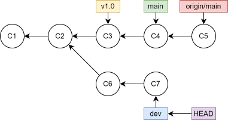
  </figure>
</div>

Answer the following questions based on the figure. Assume that each question refers to the original state of the repository illustrated in the figure. When describing changes to references, consider only those shown in the figure.

1. What are the current branch and the current commit? How does `HEAD` identify the current commit?

::: {.callout-note title="Solution" collapse="true" icon="false"}

The current branch is `dev`, and the current commit is C7. `HEAD` identifies the current commit indirectly through the `dev` branch reference.

:::
   

2. Which references would change if we switched to the `main` branch? Which commit would then be the current commit?

::: {.callout-note title="Solution" collapse="true" icon="false"}

Git would update `HEAD` to point to the `main` branch reference rather than the `dev` branch reference. All the other references would remain unchanged.

The current commit would then be C4.

:::

3. Which references would change if we created a new commit without first switching branches?

::: {.callout-note title="Solution" collapse="true" icon="false"}

Git would update the `dev` branch reference to point to the newly created commit. All the other references, including `HEAD`, would remain unchanged.

Because `HEAD` identifies the current commit indirectly through the `dev` branch reference, the newly created commit would become the current commit.

:::

4. Suppose that we switched to the `main` branch and performed a fast-forward merge of `origin/main` into `main`. Which references would change? Would any new commit objects be created?

::: {.callout-note title="Solution" collapse="true" icon="false"}

Git would update `HEAD` to point to the `main` branch reference when we switched to the `main` branch.

When we subsequently performed the fast-forward merge, Git would update the `main` branch reference to point to C5 rather than C4. No other references would change as a result of the merge.

No new commit objects would be created, since a fast-forward merge moves the reference for the current branch to an existing commit.

:::

5. Which references would change if we used `git reset` to change the current commit to C6? Would any commit objects be immediately removed from the repository?

::: {.callout-note title="Solution" collapse="true" icon="false"}

Git would update the `dev` branch reference to point to C6 rather than C7. All the other references, including `HEAD`, would remain unchanged.

Although C7 would no longer be part of the history of the `dev` branch, the commit object would not immediately be removed from the repository.

:::

6. Suppose that we switched to the `main` branch and forcibly deleted the `dev` branch. Which references would change or be removed? Would any commit objects be immediately removed from the repository?

::: {.callout-note title="Solution" collapse="true" icon="false"}

Git would update `HEAD` to point to the `main` branch reference when we switched to the `main` branch. Git would then remove the `dev` branch reference when we deleted the branch.

Although commits C6 and C7 would no longer be part of the history of any branch, neither commit object would immediately be removed from the repository.

:::

7. Does the remote-tracking branch `origin/main` tell us with certainty which commit the `main` branch in the remote repository currently points to? Explain your answer.

::: {.callout-note title="Solution" collapse="true" icon="false"}

No. The remote-tracking branch `origin/main` records the last known state of the `main` branch in the remote repository. Changes may have been made to the `main` branch in the remote repository without the `origin/main` reference having been updated.

:::

8. Suppose that we used `git switch --detach v1.0` to switch to the commit identified by the `v1.0` tag. Which references would change? Which commit would then be the current commit?

::: {.callout-note title="Solution" collapse="true" icon="false"}

Git would update `HEAD` to point directly to C3 rather than to a branch reference. All the other references would remain unchanged.

The current commit would then be C3, and the repository would be in a detached HEAD state.

:::

9. Which commits are identified by the expressions `main^`, `dev~2`, `origin/main~2`, and `HEAD^`?

::: {.callout-note title="Solution" collapse="true" icon="false"}

The expressions identify the following commits:

- `main^` identifies C3.

- `dev~2` identifies C2.

- `origin/main~2` identifies C3.

- `HEAD^` identifies C6.

Since `HEAD` identifies the current commit indirectly through the `dev` branch reference, `HEAD^` and `dev^` identify the same commit.

:::
