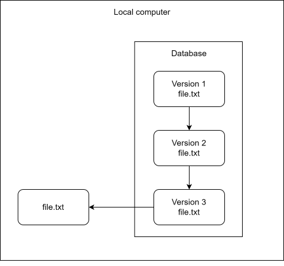
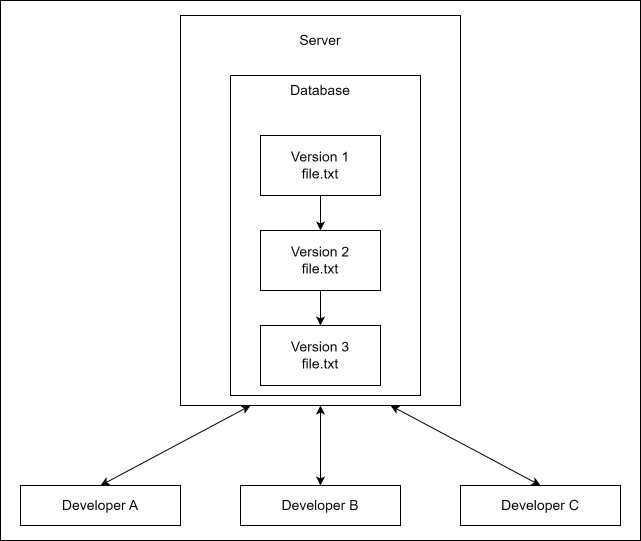
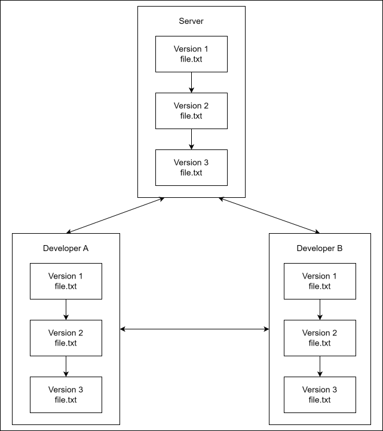
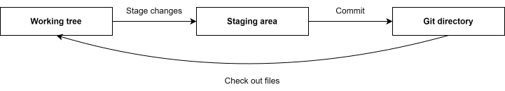
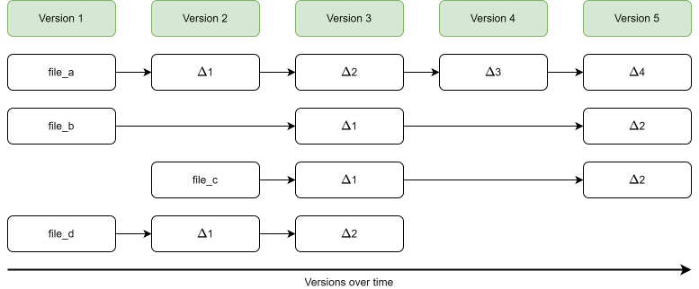
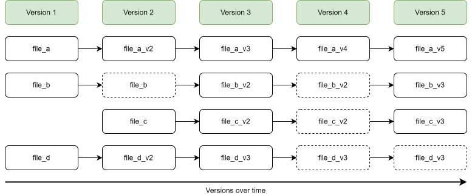

# Introduction to version control and Git {#sec-introduction-to-git}

What is version control, and what is Git? We will begin this tutorial with a brief introduction to version control before explaining what Git is and how it works at a broad level.

## What is version control?

*Version control* is the practice of organizing and tracking different versions of computer files over time. Version control can be used for almost any type of file, but is particularly useful for source code, which is typically stored in plain-text files. A *version control system* (VCS) is software that helps manage and track changes to files.

You might not realize it, but you are probably already using some form of primitive version control. Do the filenames below look familiar? It is common for people to do manual version control by making copies of files and renaming them. You might even create a separate folder for older versions. The filenames shown here might seem exaggerated, but inconsistent naming like this is common in practice.

<pre class="dir-structure"><code>scripts/
├── code.txt
├── code-2026-01-01.txt
├── code-final.txt
├── code-final-2026-02-02.txt
└── code-final-fix.txt</code></pre>

Even with a single file, manual version control quickly makes it difficult to determine which version of the file is the newest, and whether the versions follow a linear history or have diverged from a common starting point. It is also difficult to determine exactly what has changed between versions. Even for small projects with a single developer, this approach clearly has serious limitations.

Using a VCS provides a more structured way of managing different versions of files. A VCS addresses many of the problems with manual version control. It keeps a history of changes, making it possible to see what has changed, when it changed, and who made the changes. It also makes it easier to restore previous versions of files and, depending on the type of VCS, collaborate with others on the same project.

### Local VCS

One type of version control system is a *local VCS*. A local VCS uses a database on your computer, where changes to files are tracked. Using a local VCS is an improvement over manual version control and can be useful for small or personal projects, but this type of VCS still has important limitations:

- All file versions are stored on your computer, making them vulnerable to data loss if that computer fails.

- It is difficult to collaborate with others using a local VCS, since changes cannot easily be shared or consolidated.

### Centralized VCS

In a *centralized VCS*, the version history is stored in a central database on a server. Developers can check out files from the database and commit changes back to it. A *commit* records a version of the project in its history. Centralized VCSs have several advantages over local VCSs.

- A single central database makes it easy for developers to see the history of changes and the current state of files.

- A central database also makes it easier to collaborate with others.

- Administrators can control what files each developer can access and modify.

However, centralized VCSs still have limitations:

- If the server fails and no proper backup exists, the project's version history may be lost, although developers may still have copies of individual files stored locally.

- Committing changes typically requires access to the central server, making it difficult to work fully offline.

- Many operations require communication with the central server, which can make them slower.

### Distributed VCS

A different approach is the *distributed VCS*. With a distributed VCS, each developer typically has a local copy of the database containing the project's version history. Distributed VCSs have several advantages over centralized VCSs.

- Because multiple copies of the database exist, the version history is less vulnerable to the failure of a single computer or server.

- Developers can share and synchronize changes directly with each other, or agree to use one central database for sharing changes.

- Developers can work offline.

- Some operations are faster because they can be performed locally without communicating with a server.

However, distributed VCSs also have some limitations:

- Storing the complete database history can take up more disk space, especially if the project contains binary files or has a long and complicated history.

- It is difficult to control which files individual developers can access, since they typically have a complete copy of the database.

## What is Git?

So what is Git, and how did it come to be? Git is a distributed VCS, and it was born out of controversy. In 2005, relations broke down between the Linux kernel development community and the company behind BitKeeper, the proprietary distributed VCS they had been using. This resulted in the withdrawal of BitKeeper's free-of-charge availability to Linux kernel developers. In response, the Linux development community, particularly Linus Torvalds, developed Git as a replacement for BitKeeper.

Git was designed to meet several important requirements of the Linux kernel project: speed, a simple design, strong support for non-linear development, a fully distributed model, and the ability to handle large projects efficiently.

In Git, a project and its version history are managed in a *repository*, often shortened to *repo*. Git works by recording snapshots of your files over time. Git makes it easy to switch between versions of your files, compare versions of the same file, and review the history of individual files.

Although Git was originally developed for large projects involving many developers, it is equally useful for small projects with a single developer.

### Main parts of a Git project

A typical Git project consists of three main parts: the Git directory, the working tree, and the staging area.

{width=100%}

The *Git directory* is where Git stores the history of your project, including previous versions of your files. In a typical Git repository, the Git directory is a hidden subdirectory named `.git` within the working tree.

The *working tree* consists of the files and directories you work with in your project. In a typical Git repository, these are located in the main project directory, alongside the hidden `.git` directory. This is where you view and modify your project files.

The *staging area* contains a snapshot of the files that will be recorded in the next commit.

The typical Git workflow is a cycle involving the following steps:

1. Modify files in the working tree.

2. Stage the changes you want to include in the next commit.

3. Commit the staged changes to the Git repository.

### How Git stores data {#sec-file-storage-in-git}

A major difference between Git and many other VCSs is how Git stores data. Many other VCSs represent file histories by storing an initial version of each file and the changes made in subsequent versions. This is commonly called *delta-based* version control.

Git takes a different approach. Rather than representing each version as a collection of changes to individual files, Git represents versions of a project as snapshots of its files. Every time you commit changes, Git records a new snapshot. To be efficient, Git can reuse the stored contents of files that have not changed.

### Summary

Version control provides a structured way to track changes to files, restore earlier versions, and collaborate with others. Git is a distributed version control system that allows developers to keep and work with a project's history locally. In the following chapters, we will look at how to use Git in practice and how Git works in more detail.
