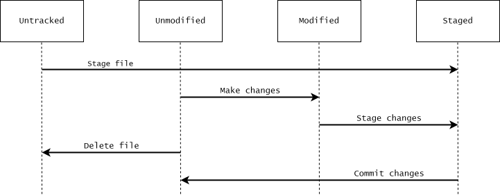

# Getting started {#sec-getting-started}

In this chapter, we will configure some basic Git settings and introduce the essential Git commands for creating a repository, staging changes, and making commits. We will also explain how to ignore certain files and access Git's documentation.

We assume that you are familiar with using Git Bash to work from the terminal. If you are not, start by reading @sec-git-bash.


## Basic configuration of Git {#sec-getting-started-basic-config}

Before getting started, we need to configure a few basic Git settings using the `git config` command. Here, we will simply show which commands to use. For a more detailed explanation of Git configuration, see @sec-configuration-of-git.


### Change the core editor

Git for Windows includes the Vim text editor, and Vim is the default text editor in a typical Git for Windows installation. Git uses Vim for writing commit messages and other text. Vim can be difficult to use if you are unfamiliar with it, so we recommend choosing a simpler text editor. The only thing we will explain about Vim is how to exit it if you open it by accident: press `<Esc>` to make sure you are in normal mode, type `:q!`, and press `<Enter>`. This quits Vim and discards any unsaved changes.

This tutorial is aimed at Windows users, so Notepad is a sensible choice of text editor. To configure Git to use Notepad, which comes pre-installed with Windows, run:

<pre class="terminal">
$ git config set --global core.editor notepad
</pre>

This tells Git to use Notepad as a text editor in all your Git repositories. Git should be able to locate the Notepad executable. If not, specify its full path, which is typically `C:/Windows/System32/notepad.exe`:

<pre class="terminal">
$ git config set --global core.editor "C:/Windows/System32/notepad.exe"
</pre>


### Identify yourself

You should also configure your name and email address, which are recorded as the author information in your commits. You can specify this with the following commands:

<pre class="terminal">
$ git config set --global user.name "Your name"
$ git config set --global user.email "your@email.com"
</pre>


## Initializing and cloning Git repositories

To start using Git, you can either initialize a new Git repository or clone an existing one.

### Initialize a Git repository

To initialize a Git repository in a directory, use `git init`:

<pre class="terminal">
<span class="col-user-id">username@computer-id</span> <span class="col-compiler">MINGW64</span> <span class="col-cd">~</span>
$ mkdir ~/example-getting-started
$ cd ~/example-getting-started
<span class="col-user-id">username@computer-id</span> <span class="col-compiler">MINGW64</span> <span class="col-cd">~/example-getting-started</span>
$ git init
Initialized empty Git repository in C:/Users/username/example-getting-started/.git/
<span class="col-user-id">username@computer-id</span> <span class="col-compiler">MINGW64</span> <span class="col-cd">~/example-getting-started</span> <span class="col-prompt-branch">(main)</span>
$ ls -A
<span class="col-dir">.git</span>/
</pre>

As shown in the output of `git init`, this creates a hidden subdirectory named `.git`, which contains the Git repository's internal data. Notice that the terminal prompt now ends with `(main)`. This is Git Bash telling us that we are in a Git repository and on the `main` branch. Depending on your Git installation, the name might be `master` instead of `main`. We will talk more about branches in @sec-branching-and-merging. 


### Clone an existing Git repository

To clone an existing Git repository, use `git clone`. By default, `git clone` creates a new directory inside your current working directory and copies the repository into it. You can clone a repository from another directory on your computer, from a directory on a network drive, or from a URL. The source code for this tutorial is available on GitHub. For example, you can clone the repository into your home directory using the following commands:

<pre class="terminal">
$ cd ~
$ git clone "https://github.com/thomas-rasmussen/git-tutorial.git"
</pre>

This creates a directory named `git-tutorial` containing a copy of the repository.


## States of files

Before introducing the commands for staging and committing changes, we need to introduce some terminology for describing the different states of files.

Each file in the working tree is either *tracked* or *untracked*. Tracked files are files that Git knows about, meaning files that have previously been committed or added to the staging area. All other files are untracked.

Tracked files can be unmodified or modified, and their changes can be either staged or unstaged. When we modify a tracked file, Git can detect that its contents differ from those in the staging area. When we stage these changes, Git updates the staging area with the current contents of the file.

A file can also have both staged and unstaged changes if we modify it again after staging it. We will explore this distinction later in the tutorial.

{width=100%}


## Checking the state of files

The main command for checking the state of files is `git status`. If we run this command in the empty `example-getting-started` repository created earlier, we see the following output:

<pre class="terminal">
<span class="col-user-id">username@computer-id</span> <span class="col-compiler">MINGW64</span> <span class="col-cd">~/example-getting-started</span> <span class="col-prompt-branch">(main)</span>
$ git status
On branch main

No commits yet

nothing to commit (create/copy files and use "git add" to track)

</pre>

There are no commits in the repository, and no files have been added to the staging area. Git also suggests creating files and using `git add` to track them.


## Adding changes to the staging area

To add changes to the staging area, we use the `git add` command. The staging area represents the snapshot that will be recorded in the next commit, including the unchanged files from the previous commit. When we use `git add`, Git updates this snapshot to reflect the current contents of the specified files in the working tree. This can include adding new files, updating existing files, or recording the deletion of files. The staging area is also commonly called the *index* in Git's documentation. Throughout this tutorial, we will generally use the term *staging area*.

Continuing our example, we first create a file in the working tree:

<pre class="terminal">
<span class="col-user-id">username@computer-id</span> <span class="col-compiler">MINGW64</span> <span class="col-cd">~/example-getting-started</span> <span class="col-prompt-branch">(main)</span>
$ echo "Contents of file1.txt" > file1.txt
</pre>

We now have an untracked file in our repository. If we run `git status` again, we see the following output:

<pre class="terminal">
$ git status
On branch main

No commits yet

Untracked files:
  (use "git add <file>..." to include in what will be committed)
<span class="col-status-untracked">        file1.txt</span>

nothing added to commit but untracked files present (use "git add" to track)

</pre>

Now we add `file1.txt` to the staging area:

<pre class="terminal">
$ git add file1.txt
warning: in the working copy of 'file1.txt', LF will be replaced by CRLF the next time Git touches it
</pre>

We can stage multiple files at once. For example, `git add file1.txt file2.txt` stages two specified files. The command `git add .` stages changes to all relevant files in the current directory and its subdirectories, respecting Git's ignore rules.

Depending on your Git configuration, you may see a warning about line endings when staging a file. This is related to differences in how Windows and other operating systems represent line endings in text files. The warning does not prevent us from staging the file, and we do not need to examine the details here.

The file `file1.txt` is now tracked, with its contents staged for the next commit. Let's run `git status` again:

<pre class="terminal">
$ git status
On branch main

No commits yet

Changes to be committed:
  (use "git rm --cached <file>..." to unstage)
<span class="col-status-added">        new file:   file1.txt</span>

</pre>

The output confirms that `file1.txt` is staged and will be included in the next commit. Git also suggests a command for removing the file from the staging area. We will discuss this command later in the tutorial.


## Committing files to the repository

We have now seen how to add changes to the staging area using `git add`. To commit changes in the staging area to the repository, use `git commit`. This creates a new commit in the repository using the snapshot recorded in the staging area. Continuing our example:

<pre class="terminal">
<span class="col-user-id">username@computer-id</span> <span class="col-compiler">MINGW64</span> <span class="col-cd">~/example-getting-started</span> <span class="col-prompt-branch">(main)</span>
$ git commit
</pre>

After running the command, Git opens the configured text editor, where you can write a commit message. After writing the message, save the file and exit the editor. This is why we configured Git's text editor earlier in the chapter. 

You can also use the `-m` option to write a commit message directly:

<pre class="terminal">
$ git commit -m"Commit message"
</pre>

After creating the commit, `git commit` displays output similar to the following:

<pre class="terminal">
[main (root-commit) b68a80a] Commit message
 1 file changed, 1 insertion(+)
 create mode 100644 file1.txt
</pre>

The output confirms that the commit was created and that it contains changes to `file1.txt`.

After committing `file1.txt` to the repository, `file1.txt` goes back to being unmodified, since the file now matches the version recorded in the latest commit. We can check this by running `git status` again:

<pre class="terminal">
$ git status
On branch main
nothing to commit, working tree clean
</pre>


## Viewing differences

We now have a commit in our example repository. Let's make some additional changes to `file1.txt`:

<pre class="terminal">
<span class="col-user-id">username@computer-id</span> <span class="col-compiler">MINGW64</span> <span class="col-cd">~/example-getting-started</span> <span class="col-prompt-branch">(main)</span>
$ echo "New changes" >> file1.txt
$ git status
On branch main
Changes not staged for commit:
  (use "git add <file>..." to update what will be committed)
  (use "git restore <file>..." to discard changes in working directory)
<span class="col-status-modified">        modified:   file1.txt</span>

no changes added to commit (use "git add" and/or "git commit -a")

</pre>

As shown above, this changes the status of `file1.txt` from unmodified to modified. Git also informs us that we can discard the changes in the working tree using `git restore`. We will talk more about `git restore` in @sec-undoing-changes.

At this point, `file1.txt` is tracked, and we have modified the file in the working tree. We can use `git diff` to view changes in the working tree that have not yet been staged:

<pre class="terminal">
$ git diff
<span class="col-diff-header">diff --git a/file1.txt b/file1.txt</span>
<span class="col-diff-metadata">index 85e8799..0bcb801 100644</span>
<span class="col-diff-markers">--- a/file1.txt</span>
<span class="col-diff-markers">+++ b/file1.txt</span>
<span class="col-diff-hunk-header">@@ -1 +1,2 @@</span>
 Contents of file1.txt
<span class="col-diff-added">+New changes</span>

</pre>

The line `+New changes` indicates that the content `New changes` has been added to the working-tree version of the file. We will explain how to use `git diff` in more detail in @sec-git-diff.

Let's add the changes to the staging area and commit them:

<pre class="terminal">
$ git add file1.txt
$ git commit -m"Add changes to file1.txt"
</pre>


## Viewing the commit log

We have now created two commits in our example. To view the repository's commit history, we use `git log`:

<pre class="terminal">
<span class="col-user-id">username@computer-id</span> <span class="col-compiler">MINGW64</span> <span class="col-cd">~/example-getting-started</span> <span class="col-prompt-branch">(main)</span>
<span class="col-yellow">commit 91860202c61448c4c72ca70709a6e843b51d6a0c (</span><span class="col-head">HEAD</span> <span class="col-yellow">-></span> <span class="col-branch-local">main</span><span class="col-yellow">)</span>
Author: Your Name &lt;your@email.com&gt;
Date:   &lt;Date and time of commit&gt;

    Add changes to file1.txt

<span class="col-yellow">commit 5daad2bc8d1280cf7bf0d83ef2a7c676ff50028b</span>
Author: Your Name &lt;your@email.com&gt;
Date:   &lt;Date and time of commit&gt;

    Commit message

</pre>

The output shows the author, date, and message of each commit. We will discuss `git log` in more detail in @sec-inspecting-the-commit-history.


## Ignoring files

A repository will often contain files that you do not want Git to track. For example, you might store supporting documents in your project directory without wanting to version-control them. 

You can create a file named `.gitignore` in your repository to specify which files Git should ignore. Each line specifies an ignore pattern, except for empty lines and comments. For example, a `.gitignore` file might look like this:

```{=html}
<div class="notepad-file">
<div class="notepad-header">.gitignore</div>
<div class="notepad-body">
<pre>
# Lines starting with a "#" are comments.

# Ignore project description
project-description.pdf

# Ignore all files ending in ".pdf" or ".docx" in "doc" subdirectory
doc/*.pdf
doc/*.docx

# Ignore large dataset file in "data/" subdirectory.
data/large-dataset.txt
</pre>
</div>
</div>
```

Patterns in `.gitignore` do not cause Git to stop tracking files that are already tracked.

Although `.gitignore` files are important in real projects, we will not discuss them further in the main chapters of this tutorial. For more information about ignoring files when using Git, see @sec-ignoring-files.


## Accessing manual pages

We will end this chapter by explaining how to access Git's documentation. There are several ways to access the manual pages. One is the `git help` command. For example, to open the manual page for `git add`, run:

<pre class="terminal">
$ git help add
</pre>

The manual pages are available locally, so you can consult them even without an internet connection. You can also display a concise summary of a command's options directly in the terminal using the `-h` option with a Git command. For example, run `git add -h` to display a summary of the options available for `git add`.


## Summary

In this chapter, we have introduced the basic commands needed to start using Git. We have learned how to initialize or clone a repository, inspect the state of files, stage changes, and create commits. We have also introduced commands for viewing differences and commit history, explained how to ignore files, and shown how to access Git's documentation.

The most important concept is the distinction between the working tree, staging area, and repository. Understanding how changes move between these components is fundamental to using Git.


## Exercises

### Exercise 1 - Create your first repository

In this exercise, you will practice creating a repository, staging and committing changes, and identifying the state of files at each step in the process.

<b>1. Create a repository.</b>

Create a directory named `ex01-getting-started` in your home directory, navigate into it, and initialize a Git repository.

::: {.callout-tip title="Hint" collapse="true" icon="false"}

You can create directories with `mkdir` and change the current working directory using `cd`.

:::

::: {.callout-note title="Solution" collapse="true" icon="false"}

<pre class="terminal">
$ mkdir ~/ex01-getting-started
$ cd ~/ex01-getting-started
$ git init
</pre>

:::

<b>2. Create a file.</b>

Create a file named `file1.txt` in `ex01-getting-started`. The file should contain the string "Contents of file1.txt". After creating the file, consider whether the file is unmodified, modified, or staged at this point. Use `git status` to check.

::: {.callout-tip title="Hint" collapse="true" icon="false"}

Use `echo` and the `>` redirection operator to save the string in `file1.txt`.

:::

::: {.callout-note title="Solution" collapse="true" icon="false"}

<pre class="terminal">
$ echo "Contents of file1.txt" > file1.txt
$ git status
On branch main

No commits yet

Untracked files:
  (use "git add <file>..." to include in what will be committed)
<span class="col-status-untracked">        file1.txt</span>

nothing added to commit but untracked files present (use "git add" to track)

</pre>

The file is currently untracked, since it has not been added to the staging area and has not previously been committed. Since it is untracked, the file is neither unmodified, modified, nor staged.

:::

<b>3. Stage the file.</b>

Add `file1.txt` to the staging area. After adding it, consider the state of the file. Is it now tracked? If yes, is it unmodified, modified, or staged?

::: {.callout-note title="Solution" collapse="true" icon="false"}

<pre class="terminal">
$ git add file1.txt
$ git status
On branch main

No commits yet

Changes to be committed:
  (use "git rm --cached <file>..." to unstage)
<span class="col-status-staged">        new file:   file1.txt</span>

</pre>

The file has been added to the staging area, so the file is now tracked and its contents are staged.

:::

<b>4. Commit changes.</b>

Commit the staged file to the repository. In what state is `file1.txt` after the commit? Use `git status` to check.

::: {.callout-note title="Solution" collapse="true" icon="false"}

<pre class="terminal">
$ git commit -m"Add file1.txt"
$ git status
On branch main
nothing to commit, working tree clean

</pre>

The file is now unmodified because it matches the version recorded in the commit.

:::

<b>5. Modify and commit the file again.</b>

Make additional changes to `file1.txt`, stage them, and commit again. In each step, consider what state the file is in.

::: {.callout-note title="Solution" collapse="true" icon="false"}

The file is currently tracked and unmodified. Next, we make some changes to the file:

<pre class="terminal">
$ echo "More changes" >> file1.txt
$ git status
On branch main
Changes not staged for commit:
  (use "git add <file>..." to update what will be committed)
  (use "git restore <file>..." to discard changes in working directory)
<span class="col-status-not-staged">        modified:   file1.txt</span>

no changes added to commit (use "git add" and/or "git commit -a")

</pre>

The file is now modified: it contains changes that have not yet been staged. Next we add the changes to the staging area:

<pre class="terminal">
$ git add file1.txt
$ git status
On branch main
Changes to be committed:
  (use "git restore --staged <file>..." to unstage)
<span class="col-status-staged">        modified:   file1.txt</span>

</pre>

The file is now staged. Finally, we commit the changes:

<pre class="terminal">
$ git commit -m"Update file1.txt"
$ git status
On branch main
nothing to commit, working tree clean

</pre>

After committing the changes, `file1.txt` goes back to being unmodified.

:::


### Exercise 2 - Learn to use Git documentation

Knowing how to consult Git's documentation is useful when learning new commands or looking up options. In this exercise, you will consult the documentation to find an option that makes the output of `git status` more concise.

<b>1. Set up a repository.</b>

- Create a directory named `ex02-getting-started` in your home directory, navigate to it, and initialize a repository.

- Create a file named `file1.txt` with the line `Contents of file1.txt`.

- Add the file to the staging area and make a commit.

- Add changes to `file1.txt`.

- Create a file named `file2.txt` with the line `Contents of file2.txt` and add it to the staging area.

- Create a file named `file3.txt` with the line `Contents of file3.txt`.

::: {.callout-note title="Solution" collapse="true" icon="false"}

<pre class="terminal">
$ mkdir ~/ex02-getting-started
$ cd ~/ex02-getting-started
$ git init
$ echo "Contents of file1.txt" > file1.txt
$ git add file1.txt
$ git commit -m"Add file1.txt"
$ echo "More content" >> file1.txt
$ echo "Contents of file2.txt" > file2.txt
$ git add file2.txt
$ echo "Contents of file3.txt" > file3.txt
</pre>

:::

<b>2. Display a shorter version of the `git status` output.</b>

Running `git status` at this point produces the following output:

<pre class="terminal">
$ git status
On branch main
Changes to be committed:
  (use "git restore --staged <file>..." to unstage)
<span class="col-status-staged">        new file:   file2.txt</span>

Changes not staged for commit:
  (use "git add <file>..." to update what will be committed)
  (use "git restore <file>..." to discard changes in working directory)
<span class="col-status-not-staged">        modified:   file1.txt</span>

Untracked files:
  (use "git add <file>..." to include in what will be committed)
<span class="col-status-untracked">        file3.txt</span>

</pre>

The output is rather verbose. Consult the documentation for `git status` to find an option that displays the status more concisely.

::: {.callout-tip title="Hint" collapse="true" icon="false"}

You can either look at the "OPTIONS" section of the manual page using `git help status`, or you can use `git status -h` to get a quick overview of how to use the command.

:::

::: {.callout-note title="Solution" collapse="true" icon="false"}

The `-s` option produces the short status format:

<pre class="terminal">
$ git status -s
<span class="col-red"> M </span>file1.txt
<span class="col-green">A  </span>file2.txt
<span class="col-red">?? </span>file3.txt
</pre>
:::

<b>3. Further explore the documentation.</b>

The output of `git status -s` from the previous step uses shorthand notation that might not be immediately clear. Consult the "OUTPUT" section of the manual page for `git status` to learn what the notation means.


::: {.callout-note title="Solution" collapse="true" icon="false"}

The short format uses two status columns. For tracked files, the first column describes changes in the staging area, while the second describes changes in the working tree. The letter `M` indicates a modification, `A` indicates an added file, and `??` indicates an untracked file.

:::


### Exercise 3 - Start using Git in an existing project (optional)

In this exercise, you will start using Git in one of your existing projects:

1. Navigate to the directory containing your project and initialize a Git repository.

2. Consider which files should be version-controlled and which should be ignored. If necessary, create a `.gitignore` file.

3. Stage the files you want to version-control.

4. Use `git status` to check which files will be included in the commit.

5. Commit the staged files.

Congratulations! You are now using Git to version-control your project. This is all it takes to get started.