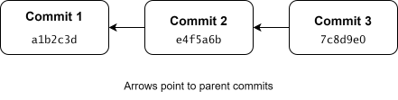

# Inspecting the commit history {#sec-inspecting-the-commit-history}

In the previous chapter, we briefly introduced `git log`. In this chapter, we will explore how to inspect the commit history of a repository and examine individual commits.

## Checksums

To understand how Git identifies commits, we first need to introduce the concept of checksums.

A checksum is a value calculated from data, such as the contents of a file. By default, Git uses the SHA-1 hashing algorithm to calculate checksums. The algorithm produces a 40-character hexadecimal string from the data. For example, the SHA-1 hash of the string "hello world" is:

<pre class="terminal">
2aae6c35c94fcfb415dbe95f408b9ce91ee846ed
</pre>

Adding a single space to the end of the string produces the following hash:

<pre class="terminal">
0b1f51a2c85a69ee1335df4eef69342169bd195b
</pre>

Notice that even a minor change to the input can produce a completely different hash.

Git uses checksums to identify objects stored in its internal database, including commits. When calculating the hash of an object, Git includes the object's type and size along with its contents. Because accidental hash collisions are extremely unlikely, these hashes can be treated as unique identifiers for practical purposes. The hash identifying a commit is called its *commit ID*.

## Contents of a commit

A commit represents a snapshot of the repository based on the contents of the staging area at the time the commit was created. A commit also contains information about its author, the time it was created, a commit message, and references to its parent commits. The first commit of a repository does not have a parent commit. These references to parent commits connect the commits into a history.

TODO: Is the first sentence above correct enough or just misleading? The content of the snapshot depends on the content of the index, not the files in the repository?

{fig-align="center"}

## Inspecting commit history with `git log`

To illustrate how to inspect the commit history of a repository, we first create a Git repository containing a single file, `file.txt`, and make two commits:

<pre class="terminal">
$ mkdir ~/example-git-log
$ cd ~/example-git-log
$ git init
$ echo "Changes in first commit" > file.txt
$ git add file.txt
$ git commit -m"First commit"
$ echo "Changes in second commit" >> file.txt
$ git add file.txt
$ git commit -m"Second commit"
</pre>

Running `git log` now produces output similar to the following:

<pre class="terminal">
$ git log
commit bd1a5e136e4acd10d16fe0e4a6199dc42b7abbed (HEAD -> main)
Author: Your Name &lt;your@email.com&gt;
Date:   &lt;Date and time of commit&gt;

    Second commit

commit ad3facc8ab413488c4195b6c39b6bd8ce89d1a40
Author: Your Name &lt;your@email.com&gt;
Date:   &lt;Date and time of commit&gt;

    First commit

</pre>

By default, `git log` shows the history leading up to the current commit, starting with that commit and working backwards through its history. For each commit, Git displays the full commit ID, the author's name and email address, the commit date, and the commit message. The output also shows `HEAD`, which normally refers to the current branch and therefore identifies the currently checked-out commit. We will explain this in greater detail later in the tutorial.

The default output of `git log` is quite verbose, and we are often interested only in the commit IDs and messages. We can use the `--oneline` option to show this information more concisely:

<pre class="terminal">
$ git log --oneline
bd1a5e1 (HEAD -> main) Second commit
ad3facc First commit
</pre>

Notice that `git log --oneline` displays abbreviated commit IDs, rather than the full 40-character IDs. Git automatically chooses an abbreviation length sufficient to distinguish objects in the repository. These abbreviated IDs can also be used to refer to commits in Git commands.

## Inspecting individual commits with `git show`

We can use `git show <commit-id>` to inspect an individual commit. For example, we can use `git log --oneline` to find the ID of the first commit and then inspect it using `git show`:

<pre class="terminal">
$ git log --oneline
bd1a5e1 (HEAD -> main) Second commit
ad3facc First commit
$ git show ad3facc
commit ad3facc8ab413488c4195b6c39b6bd8ce89d1a40
Author: Your Name &lt;your@email.com&gt;
Date:   &lt;Date and time of commit&gt;

    First commit

diff --git a/file.txt b/file.txt
new file mode 100644
index 0000000..b25e6e1
--- /dev/null
+++ b/file.txt
@@ -0,0 +1 @@
+Changes in first commit

</pre>

`git show` displays the same basic commit information as `git log`, but also shows the changes introduced by the commit. We will learn how to interpret this output in the next chapter.

## Summary

In this chapter, we explained how Git uses checksums to identify commits and how each commit represents a snapshot of the repository, together with metadata and references to its parent commits.

We then learned how to inspect the commit history of a repository using `git log`, and how the `--oneline` option provides a more concise overview. Finally, we introduced `git show`, which allows us to inspect an individual commit and the changes it introduced.

## Exercises

### Exercise 1 - Inspecting commit history

In this exercise, you will practice the commands introduced in this chapter. Note that your commit IDs will almost certainly differ from those shown in the solutions.

<b>1. Set up a repository.</b>

- Create a directory named `ex01-git-log` in your home directory.

- Create an empty file named `file1.txt` and commit it.

- Create an empty file named `file2.txt` and commit it.

::: {.callout-note title="Solution" collapse="true" icon="false"}

<pre class="terminal">
$ mkdir ~/ex01-git-log
$ cd ~/ex01-git-log
$ git init
$ touch file1.txt
$ git add file1.txt
$ git commit -m"Add file1.txt"
$ touch file2.txt
$ git add file2.txt
$ git commit -m"Add file2.txt"
</pre>

:::

<b>2. Display the commit history.</b>

Display a concise commit history in the terminal.

::: {.callout-note title="Solution" collapse="true" icon="false"}

<pre class="terminal">
$ git log --oneline
68823cd (HEAD -> main) Add file2.txt
2ebb3e0 Add file1.txt
</pre>

:::

<b>3. Compare commit IDs.</b>

Compare your commit IDs with those shown in the solution to Step 2. Are they identical? Why or why not?

::: {.callout-note title="Solution" collapse="true" icon="false"}

The commit IDs will almost certainly differ. Even if you used identical file contents and commit messages, the commits will normally have different metadata, such as author information and timestamps, which contribute to the commit IDs.

:::

<b>4. Identify the relationship between the commits.</b>

What is the relationship between the two commits in the repository?

::: {.callout-note title="Solution" collapse="true" icon="false"}

The first commit is the parent of the second commit. Since it is the initial commit in the repository, it has no parent itself.

:::

<b>5. Show information about a commit.</b>

Use an appropriate Git command to inspect the first commit.

::: {.callout-note title="Solution" collapse="true" icon="false"}

We can find the ID of the first commit using `git log --oneline` and then inspect it with `git show`.

<pre class="terminal">
$ git show 2ebb3e0
commit 2ebb3e008027ef2f137cf7b2fad15fcfef8591ba
Author: Your Name &lt;your@email.com&gt;
Date:   &lt;Date and time of commit&gt;

    Add file1.txt

diff --git a/file1.txt b/file1.txt
new file mode 100644
index 0000000..e69de29
</pre>

As we saw earlier, `git show` displays the changes introduced by a commit. Here, the output shows the creation of an empty file, but no added or removed lines.

:::

<b>6. Limit the number of displayed commits.</b>

A repository's commit history can become very long, and sometimes we only want to view the most recent commits. Consult the `git log` documentation to find an option that limits the number of displayed commits. Use this option to show only the most recent commit.

::: {.callout-tip title="Hint 1" collapse="true" icon="false"}

The abbreviated help displayed by `git log -h` may not provide enough information. Consult the full manual using `git log --help`.

:::

::: {.callout-tip title="Hint 2" collapse="true" icon="false"}

Look for an appropriate option in the "Commit Limiting" section of the documentation.

:::

::: {.callout-note title="Solution" collapse="true" icon="false"}

One solution is to use `-<number>`, where `<number>` specifies the maximum number of commits to display.

<pre class="terminal">
$ git log --oneline -1
68823cd (HEAD -> main) Add file2.txt
</pre>

:::
