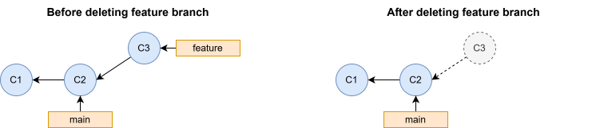

# Recovering lost commits {#sec-git-reflog}

When working with Git, you may accidentally lose commits, for example by deleting a branch before merging its changes or by resetting a branch to an earlier commit. Fortunately, the commits themselves may still exist in Git's database and can often be recovered. In this chapter, we will introduce the *reference log* (reflog) and demonstrate how it can be used to find and recover lost commits.

## What happens when commits become unreachable?

A commit is unreachable when it can no longer be reached by following the commit history from any remaining reference. Commits can become unreachable when a branch is reset to an earlier commit or when a branch containing unmerged commits is deleted.

The figure illustrates how a commit can become unreachable when a branch is deleted. Deleting the `feature` branch removes the reference pointing to commit C3. Since no other reference provides access to this commit, it becomes unreachable. However, the commit object still exists in Git's database.

Git may eventually remove unreachable commits as part of its regular maintenance. Therefore, lost commits can often be recovered, but recovery is not guaranteed indefinitely.

## Recovering commits using the reflog

When a commit becomes unreachable, we can no longer find it using `git log --all`, because this command only displays commits reachable from existing references. To recover a lost commit, we therefore need another way to identify it.

Fortunately, Git maintains *reference logs*, or *reflogs*, which record changes to references over time. These logs allow us to see which commits references have pointed to in the past. We can inspect reflogs using the `git reflog` command, which displays the reflog of `HEAD` by default. Reflogs are maintained locally and are not shared when pushing or fetching changes.

Let's see how we can use the reflog to recover a commit that becomes unreachable when a branch is deleted. We will create a repository with the history illustrated above: two commits on `main` and an additional commit on `feature`. We will then switch back to `main` and delete the `feature` branch. Because `feature` contains a commit that has not been merged into `main`, Git will refuse to delete it using `git branch -d`. We therefore use `git branch -D` to force its deletion:

<pre class="terminal">
$ mkdir ~/reflog-example
$ cd ~/reflog-example
$ git init
$ echo "Content of C1" > file.txt
$ git add .
$ git commit -m "C1"
$ echo "Content of C2" >> file.txt
$ git commit -am "C2"
$ git switch -c feature
$ echo "Content of C3" >> file.txt
$ git commit -am "C3"
$ git switch main
$ git branch -D feature
Deleted branch feature (was b2d535d).
$ git log --oneline --all
6891983 (HEAD -> main) C2
a961cba C1
</pre>

When deleting a branch, Git displays the commit ID of its tip. However, this information may no longer be available when we later discover that the branch contained commits we wanted to keep. Fortunately, we can use `git reflog` to locate the lost commit:

<pre class="terminal">
$ git reflog
6891983 (HEAD -> main) HEAD@{0}: checkout: moving from feature to main
b2d535d HEAD@{1}: commit: C3
6891983 (HEAD -> main) HEAD@{2}: checkout: moving from main to feature
6891983 (HEAD -> main) HEAD@{3}: commit: C2
a961cba HEAD@{4}: commit (initial): C1
</pre>

Each entry in the reflog shows a commit ID, a reflog entry identifier such as `HEAD@{1}`, and a description of the operation that was performed. The entries are listed in reverse chronological order, with the most recent entry at the top. The notation `HEAD@{0}` refers to the current position of `HEAD`, while `HEAD@{1}` refers to its previous position, `HEAD@{2}` to the position before that, and so on.

From the entry `HEAD@{1}`, we can see that `HEAD` previously pointed to commit C3, whose abbreviated commit ID is `b2d535d`. Although we have deleted the `feature` branch, this information is still available because the reflog of `HEAD` is maintained independently of the branch.

We can now restore the `feature` branch by creating a new branch pointing to the lost commit:

<pre class="terminal">
$ git branch feature b2d535d
$ git log --oneline --all
b2d535d (feature) C3
6891983 (HEAD -> main) C2
a961cba C1
</pre>

The `feature` branch has now been restored, and commit C3 is once again reachable.

## Summary

Deleting a branch or resetting a branch to an earlier commit can make commits unreachable without deleting them. Git maintains local reference logs, or *reflogs*, which can be used to locate lost commits. Once identified, a lost commit can be recovered by creating a new branch pointing to it or by resetting an existing branch to it. However, because reflog entries and unreachable commits are not retained indefinitely, recovery is not always possible.

## Exercises

### Recover an undone commit

In @sec-undoing-changes, we showed how `git reset` can move a branch to an earlier commit. In this exercise, you will recover a commit that becomes unreachable after such a reset.

Use the following commands to set up a repository with two commits on `main`:

<pre class="terminal">
$ mkdir ~/ex-reflog-recover-undo
$ cd ~/ex-reflog-recover-undo
$ git init
$ echo "Content" > file.txt
$ git add .
$ git commit -m "First commit"
$ echo "More content" >> file.txt
$ git commit -am "Second commit"
</pre>

<b>Step 1 - "Undo" the second commit</b>

Use `git reset` to "undo" the second commit and update the working tree and staging area to match the first commit.

::: {.callout-note title="Solution" collapse="true" icon="false"}

<pre class="terminal">
$ git reset --hard HEAD^
</pre>

:::

<b>Step 2 - Recover the commit</b>

Use `git log --all` to verify that the second commit is no longer reachable. Then use the reflog to identify the lost commit and recover it with `git reset`. Verify that the commit has been restored by inspecting the commit history.

::: {.callout-note title="Solution" collapse="true" icon="false"}

<pre class="terminal">
$ git log --oneline --all
d3e3264 (HEAD -> main) First commit
$ git reflog
d3e3264 (HEAD -> main) HEAD@{0}: reset: moving to HEAD^
9071636 HEAD@{1}: commit: Second commit
d3e3264 (HEAD -> main) HEAD@{2}: commit (initial): First commit
$ git reset --hard 9071636
$ git log --oneline
9071636 (HEAD -> main) Second commit
d3e3264 First commit
</pre>

:::
