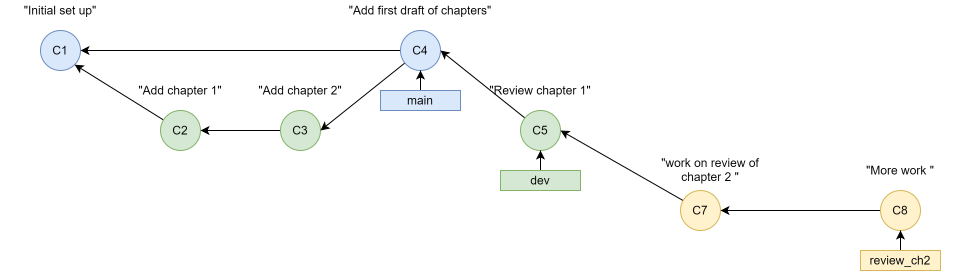

# Git workflows

Git is a flexible tool that can be used in many different ways. There is no single correct approach to organizing development with Git, and different projects may benefit from different approaches. To make effective use of Git, especially when collaborating with others, it is useful to establish a *Git workflow*.

A Git workflow is a set of guidelines for how Git is used in a project. For example, a workflow may describe how branches are used to develop new features, how changes are shared between collaborators, and when changes are integrated into the main version of the project. A workflow is not a feature of Git itself, but rather a way of organizing development using the functionality Git provides.

In this chapter, we will briefly introduce some common Git workflows and discuss when they might be appropriate. Finally, we will use the development of this tutorial as an example of how a workflow can be selected and adapted to the needs of a particular project.

## Considerations when selecting a workflow

When selecting a Git workflow, there are several things worth considering.

**Keep it simple:**

A workflow should make development easier, not more complicated. While Git provides powerful tools for organizing development and collaboration, there is no reason to use them unless they serve a purpose. An unnecessarily complicated workflow can make even simple tasks cumbersome. Generally, you should aim to use the simplest workflow that meets the needs of your project.

**Consider how the project is developed:**

A workflow that works well for a project developed by a single person may not be appropriate for a larger project with many collaborators. Consider how many people will be working on the project, whether they will be working on different tasks simultaneously, and how they will share their changes.

**Consider how changes should be integrated:**

An important consideration is how and when changes should become part of the main version of the project. For some projects, it may be perfectly acceptable to integrate changes as soon as they are made. For others, it may be important to ensure that changes have been completed, tested, or reviewed before they are integrated. For example, if a website is automatically updated whenever changes are pushed to the `main` branch, you may want to ensure that only completed changes are integrated into this branch.

**Adapt the workflow as needed:**

A workflow is a set of guidelines, not an immutable set of rules. The requirements of a project may change over time, and a workflow that was appropriate when the project started may no longer be the best choice. There is nothing wrong with modifying a workflow to better suit the needs of the project. However, when collaborating with others, it is important that everyone understands and agrees on how the workflow is used.

## The simplest possible workflow

The simplest possible Git workflow is to work directly on the `main` branch of a local repository, making commits whenever you want to save a new version of your work. There is no need to create additional branches or use remote repositories.

For example, imagine that you maintain a text document containing work-related notes. You would like to use Git to keep track of changes so that you can recover old notes that you have accidentally deleted or modified. In this case, you could simply initialize a Git repository and make a new commit whenever you update the document.

This workflow provides the basic benefits of version control without introducing any additional complexity. While it does not take advantage of many of Git's more advanced features, it may be perfectly sufficient for a small project developed by a single person.

## Centralized workflow

The centralized workflow is based on using a shared remote repository as the central location for a project. Each collaborator has their own local clone of the repository, but everyone works on the same branch, typically `main`.

Collaborators make changes and commits in their local repositories and push these commits to the central repository when they want to share their work. Before pushing, they may need to incorporate changes that other collaborators have already pushed to the central repository. If different collaborators have modified the same parts of a file, this may involve resolving merge conflicts.

The centralized workflow is relatively simple because development takes place on a single shared branch. It can work well for small teams where changes are straightforward and collaborators coordinate their work.

However, it also has limitations. Since everyone integrates their changes directly into `main`, unfinished or untested changes may become part of the shared version of the project. Furthermore, collaborators may need to coordinate their work carefully to avoid interfering with each other's changes.

## Feature branch workflow

The feature branch workflow builds upon the idea of using a shared central repository, but instead of developing changes directly on `main`, development takes place on separate branches, called *feature branches*.

When a developer wants to implement a new feature, fix a bug, or make some other change, they create a new branch for that task. Development takes place on this branch, leaving `main` unaffected. Once the work is completed, the changes are integrated into `main`, typically by merging the feature branch. The feature branch can then be deleted.

An important advantage of this workflow is that development can take place independently of the main version of the project. This makes it possible to work on unfinished features without affecting `main`, which can be reserved for completed and working versions of the project.

Feature branches also facilitate collaboration. Different developers can work on separate tasks simultaneously, and branches can be pushed to the central repository so that other collaborators can inspect and review the changes before they are integrated. On hosting services such as GitHub, this process can be organized using *pull requests*, which are introduced in more detail in @sec-introduction-to-github.

The feature branch workflow is particularly useful for projects where multiple changes are developed simultaneously, or where it is important to review or test changes before integrating them into `main`. However, using feature branches does not eliminate merge conflicts, and maintaining many branches can introduce additional complexity.

## Forking workflow

The forking workflow differs from the previous workflows primarily in how collaborators access and contribute to the central repository.

In the workflows discussed so far, collaborators generally have permission to push changes directly to the central repository. In a forking workflow, contributors instead create their own copies, or *forks*, of the central repository on a hosting service such as GitHub.

Each contributor clones their own fork and develops changes locally. They then push their changes to their fork and submit a pull request proposing that the changes be integrated into the original repository. The maintainers of the original repository can review the proposed changes and decide whether to accept them.

This workflow is particularly useful for open-source projects, where people may want to contribute without being granted permission to modify the official repository directly. It allows the maintainers to retain control over which changes are incorporated while still accepting contributions from others.

The forking workflow can also be combined with the feature branch workflow. For example, a contributor may create a feature branch in their own fork and submit a pull request when the changes are ready.

## A workflow in practice: Developing this tutorial

To illustrate how a Git workflow can be selected and adapted to the needs of a project, let's consider the workflow used to develop this tutorial.

When choosing a workflow, several considerations were made:

- The tutorial was developed by a single person, so there was little need for a workflow supporting extensive collaboration.

- The repository needed to be hosted on GitHub to make the tutorial available through GitHub Pages and allow development from different computers.

- The `main` branch would be used to publish the tutorial on GitHub Pages. It was therefor desirable to keep unfinished changes separate from this branch.

- Development would involve many different tasks, such as writing new chapters, revising exisitng chapters, and creating illustrations. It would be useful to develop these changes independently using feature branches.

- It would be useful to maintain a stable development version of the tutorial that was not necessarily ready for publication.

Based on these considerations, a workflow inspired by the feature branch workflow was selected. The repository was hosted on GitHub, with `main`serving as the braanch used to publish the tutorial on GitHub Pages. A second branch, `dev`, was created to maintain a stable development version of the tutorial.

New features and revisions were developed in separate feature branches, created from `dev`. Once a task was completed, its feature branch could be merged into `dev`. When the development version had progressed sufficiently, the changes could then be integrated into `main`, triggering an update of the published tutorial.

This workflow made it possible to work on several different parts of the tutorial independently, while maintaining a stable version for publication. It also provided some flexibility in deciding when completied changes should be made publicly available.

In practice, however, the role of the `dev` branch was less pronounced that originally anticipated. Most changes were suitable for publication as sson as the corresponding feature or revision was completed. Consequently, there was often little reason to maintain separate versions of the tutorial in `dev`and `main` for extended periods.

The workflow nevertheless worked well for the project. Using feature branches proved useful for organizing development, while the `dev` branch provided an additional level of separation between development and publication when needed. In retrospect, the project could probably have been managed just as effectively without `dev`, integrating completed feature branches directly into `main`. This illustrates that a workflow can be appropriate for a project even if some aspects of it turn out to be less important than initially anticipated.

## Summary

In this chapter, we introduced the concept of Git workflows and discussed several common approaches to organizing development with Git.

- A Git workflow is a set of guidelines for how Git is used in a project, including how changes are developed, shared, and integrated.

- Different workflows are appropriate for different projects, depending on factors such as the number of collaborators and how changes should be integrated.

- Simple, centralized, feature branch, and forking workflows offer different ways of organizing development and collaboration.

- A workflow should be kept as simple as possible while still meeting the needs of the project.

- Workflows can be adapted as the requirements of a project change or as experience reveals that a different approach would be more appropriate.

## Exercise - Choosing a Git workflow

Imagine that you and a colleague are collaborating on developing code for data management and statistical analyses in a research project. You are responsible for designing and implementing the code, and your colleague primarily makes corrections and improvements to existing code.

You have created a bare Git repository in a shared directory to serve as the central remote repository. Both of you have your own local clones of this repository.

While developing the code for the project, you want to ensure that the `main` branch always contains working, although incomplete, code, while allowing both of you to work independently.

1. Which of the workflows introduced in this chapter would be most appropriate for this project?

2. Describe how you and your colleague would organize work using this workflow. Which branches would you use, and how would you integrate your changes into `main`?

3. Would there be any advantages to introducing a development branch, for example called `dev`, branching off from `main`? Do you think it would be necessary?

4. Imagine instead that you had initially developed the project on your own. Would this affect your choice of workflow? How would you adapt your workflow if a colleague later joined the project? 

::: {.callout-note title="Suggested solution" collapse="true" icon="false"}

1. A feature branch workflow would be an appropriate choice because it allows both collaborators to work independently without introducing unfinished changes into `main`. However,, a centralized workflow could also be appropriate, particularly if the collaborators coordinate their work closely and changes are relatively small.

For the remainding questions, we will assume that the collaborators have chosen to use a feature branch workflow.

2. Each collaborator could create a separate feature branch for their work. Once the changes are completed, the feature branch could be merged into `main`, and the updated `main` branch pushed to the central repository. The other collaborator could then fetch or pull these changes into their local clone.

3. An additional `dev` branch could be useful if the collaborators wanted to maintain a stable version of the code in `main`, while using `dev` to integrate changes that were still being tested or revised. Changes could then be integrated into `main` at important project milestones, such as the completion of a first draft or a new set of analyses. However, this additional separation would not necessarily be needed for the project.

4. If you developed the project on your own, a feature branch workflow would still be appropriate. You could even still use a local remote as a backup instead. Alternatively, in this case it might also be perfectly reasonable to use a simple workflow commiting directly to main, and not using any remotes.
If you were already using a feature branch workflow with a shared remote serving as a backup, relatively few chagnes would be needed. The remote could also serve as the central repository for collaboration. If you had instead used the simplest possible workflow, you could create a central remote repository and adopt either a centralized or a feature branch workflow.

:::
